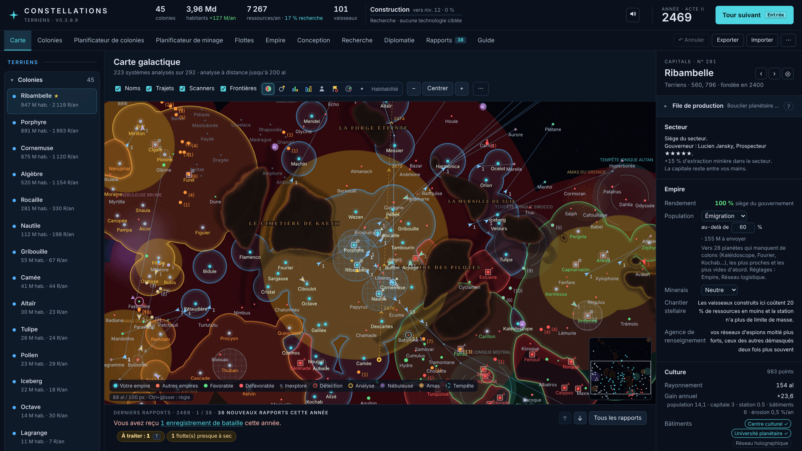
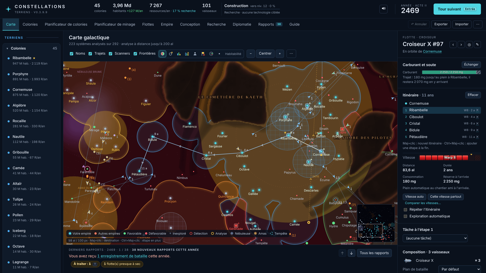
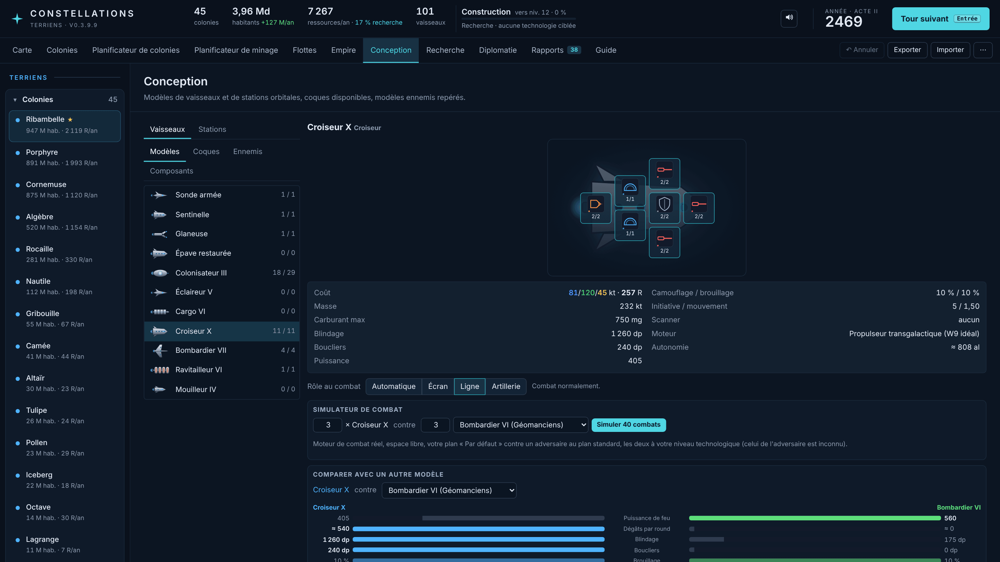
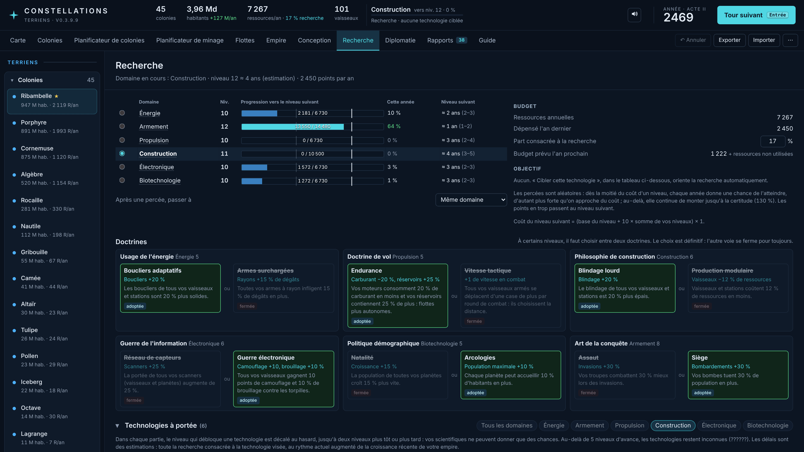
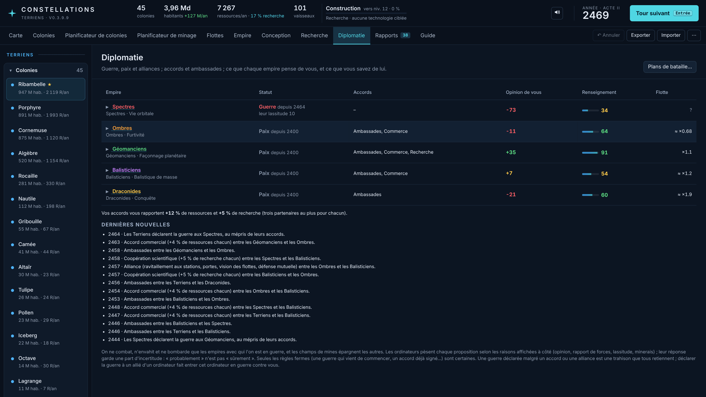
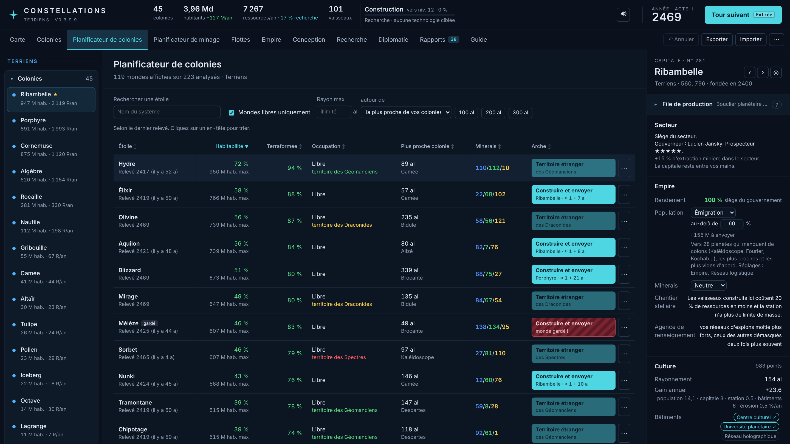
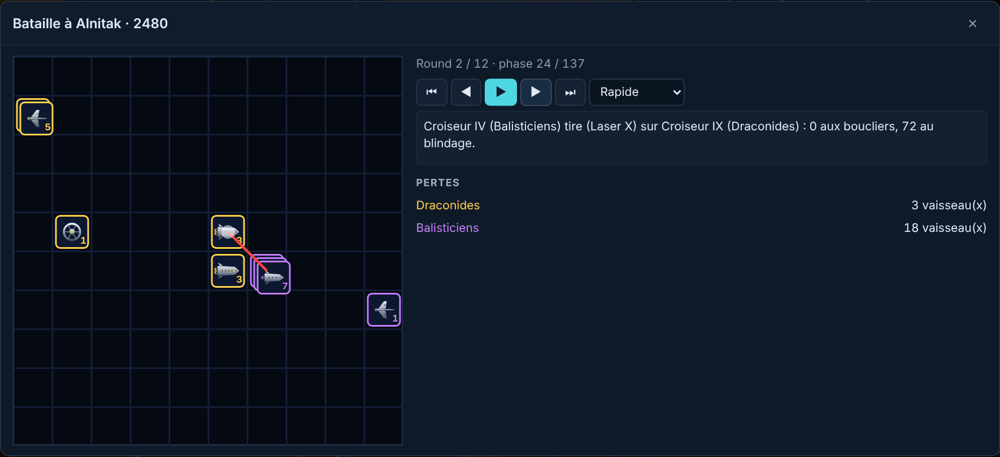
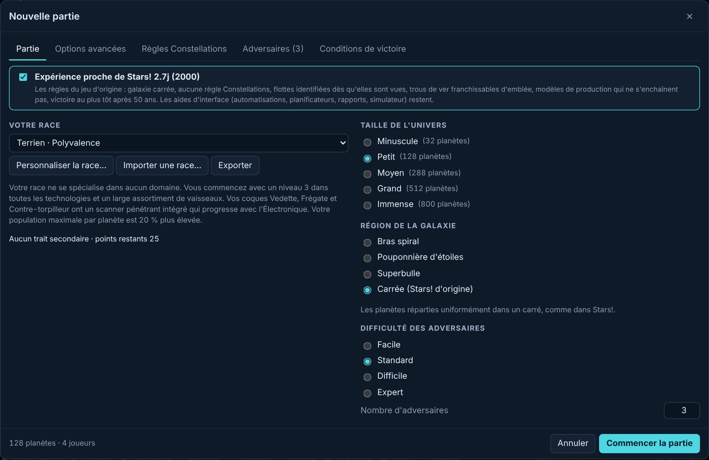

# Constellations

*[English](README.md) · Français*

Jeu de stratégie spatiale au tour par tour (4X), **librement inspiré de Stars!** (Jeff Johnson & Jeff McBride, 1995). Il tourne entièrement dans le navigateur, hors ligne, sans rien installer.

**[▶ Jouer dans le navigateur](https://intelligentrebel.github.io/constellations/)**, ou le télécharger pour jouer hors ligne (voir [Jouer](#jouer)).

**Version 0.3.9.14** (version précoce : la numérotation repart à 0.x jusqu'à ce que le jeu soit jugé complet).



## Pourquoi ce jeu

Constellations est d'abord un projet personnel : revivre un jeu des années 90 que j'aimais, Stars!, sans ce qui a mal vieilli. Stars! avait une profondeur remarquable (création de race, conception des vaisseaux, vraie économie, carburant, champs de mines, plans de bataille) derrière une interface Windows 3.1 : des dizaines de petites fenêtres, des ordres donnés une boîte de dialogue à la fois, des calculs à faire soi-même, et des limites qui ne venaient que des ordinateurs de l'époque.

Constellations garde donc les règles de Stars! comme fondation, leur donne une interface moderne avec beaucoup de confort de jeu (« quality of life »), et ajoute de nombreuses mécaniques inspirées de Stellaris et d'autres 4X, ainsi que du bon sens. Tous les noms lui sont propres (coques, composants, races, technologies) : c'est un hommage, pas une copie.

Il a été créé avec l'aide de **Claude Opus 5.5** (Anthropic).

## Captures d'écran

<table>
<tr>
<td width="50%"><br><sub>Une flotte envoyée à travers l'empire : vitesse, durée et carburant de chaque étape, ravitaillement aux chantiers amis en chemin.</sub></td>
<td width="50%"><br><sub>Conception d'un vaisseau : les emplacements de la coque, les caractéristiques, le rôle au combat, un simulateur de combat et la comparaison avec un modèle ennemi.</sub></td>
</tr>
<tr>
<td><br><sub>Recherche : l'avancement de chaque domaine, le budget, et les doctrines exclusives (l'autre voie se ferme pour de bon).</sub></td>
<td><br><sub>Diplomatie avec les ordinateurs : guerre et paix, accords, ce que chaque empire pense de vous, les dernières nouvelles.</sub></td>
</tr>
<tr>
<td><br><sub>La page Empire : découvertes et reliques, le coût de la distance à la capitale, les gouverneurs de secteur.</sub></td>
<td><br><sub>Le planificateur de colonies : chaque monde analysé classé par habitabilité, avec ses minerais et un bouton pour y envoyer une arche.</sub></td>
</tr>
<tr>
<td><br><sub>Une bataille rejouée phase par phase, avec les pertes de chaque camp.</sub></td>
<td><br><sub>Une histoire en trois actes, qui changent chacun les règles du jeu.</sub></td>
</tr>
</table>

## Jouer

- **En ligne** : [intelligentrebel.github.io/constellations](https://intelligentrebel.github.io/constellations/), rien à installer.
- **Hors ligne** : télécharger le dépôt (bouton vert **Code**, puis **Download ZIP**), le décompresser et ouvrir `index.html` dans un navigateur. Aucun serveur, aucune installation, pas besoin d'internet.
- La version en ligne et la version hors ligne gardent leurs sauvegardes séparément (chacune dans le stockage de son navigateur) : pour passer une partie de l'une à l'autre, « Exporter » puis « Importer ».
- Le jeu prend la langue du navigateur ; si elle n'est pas prise en charge, il démarre en anglais. On la change sur l'écran d'accueil ou dans le menu « ⋯ ». Langues : English, 简体中文, Deutsch, Español, Português (Brasil), Русский, Français, 日本語, 한국어, Polski, Italiano.
- Nouveau dans le jeu ? **✦ Tutoriel**, sur l'écran d'accueil, l'enseigne pas à pas dans une vraie partie, toujours sur la même carte : l'essentiel d'abord (une vingtaine de minutes), puis des chapitres facultatifs sur tout le reste. Une fiche explique chaque étape et entoure à l'écran ce dont elle parle ; les étapes qui demandent une action l'attendent, et « Le faire pour moi » l'exécute quand on bloque. On peut le fermer et le reprendre à tout moment (menu « ⋯ », ou écran d'accueil).
- Les parties sont sauvegardées automatiquement dans le navigateur (huit au plus, listées sur l'écran d'accueil). « Exporter » produit un fichier `.json` réimportable. Les tableaux s'exportent en CSV. Chrome et Edge peuvent aussi garder des fichiers de secours des derniers tours dans un dossier choisi.
- L'onglet Guide (F1) explique la prise en main et liste les raccourcis.

## Pour les puristes : une expérience proche de l'original

**Nouvelle partie, onglet Partie : « Expérience proche de Stars! »** désactive d'un coup toutes les règles de Constellations : galaxie carrée, aucune mécanique nouvelle, flottes identifiées dès qu'elles sont vues, trous de ver franchissables d'emblée, modèles de production qui ne s'enchaînent pas, victoire au plus tôt après 50 ans. Les formules sont celles de Stars! (tirées de son aide décompilée et du projet libre craig-stars, vérifiées contre le jeu original sous Windows 3.11).

Les améliorations d'interface restent : on joue aux règles de Stars! avec le confort d'un jeu moderne. Chaque règle nouvelle peut aussi s'activer ou se désactiver une par une.

<p align="center"></p>

## Ce qui change par rapport à Stars!

### Interface et confort de jeu

- Un seul écran moderne : carte, onglets (colonies, planificateurs de colonies et de minage, flottes, empire, conception, recherche, diplomatie, rapports, guide), un panneau latéral pour la sélection, et des raccourcis clavier pour tout.
- Chaque rapport est cliquable : le nom d'une planète, d'une flotte ou d'une bataille l'ouvre. Les rapports sont triés par importance et les constructions courantes résumées en une ligne par an.
- Des infobulles expliquent chaque technologie, chaque composant et chaque chiffre ; tous les tableaux se trient ; annulation (Ctrl+Z) des ordres.
- Missions en un clic : envoyer un éclaireur, une arche ou une foreuse, ou en construire une qui partira d'elle-même une fois prête.
- Trajets : jauge de carburant avec la prévision, vitesse et durée de chaque étape, étapes franchies sans s'arrêter, alertes quand le carburant manque, en surrégime ou à travers un champ de mines connu (en ne ralentissant que dans le champ), graphiques des moteurs.
- Interception en un clic avec poursuite permanente, ravitaillement en vol, ravitailleurs en poste, fusion et séparation des flottes, exploration automatique (une technologie à rechercher, comme dans Stellaris : explorer à la main en début de partie fait partie du plaisir).
- Flottes étrangères : vitesse, cap et trajectoire estimés dès la deuxième observation, alertes quand l'une semble se diriger vers un de vos mondes.
- Modèles de production qui suivent une colonie à mesure qu'elle grandit, éléments automatiques, objectifs de recherche (viser une technologie et savoir quand elle arrive), simulateur de combat, comparaison des modèles côte à côte, rediffusion des batailles.
- Une file « À traiter » (touche T) de tout ce qui attend un ordre cette année ; une course à la victoire (touche W) ; une chronique de la partie avec la rediffusion de la carte (touche H) ; une page à partager en fin de partie ; des succès.
- Les modèles de vaisseaux se retirent sans détruire les vaisseaux déjà construits (une limite de 1996 qui n'avait aucun sens).
- Populations affichées en millions, taille du texte et palettes pour daltoniens, musique adaptative et effets sonores.
- Plusieurs joueurs : sur un même appareil (chacun son tour), ou chacun chez soi par fichiers de tour, comme Stars! par courrier.

### Règles nouvelles (chacune se désactive)

- **Cartes réalistes** : une partie se déroule dans une région de galaxie (le bord d'un bras spiral, une pouponnière d'étoiles, une superbulle), avec des nuages sombres infranchissables que les flottes contournent, des nébuleuses, des amas denses, des tempêtes ioniques qui dérivent, des étoiles cachées trouvées par des quêtes, et des cataclysmes annoncés (supernovas, trou noir errant).
- **Empire** : le rendement baisse loin d'une capitale, capitales régionales, mondes conquis qui mettent une génération à produire pleinement ; gouverneurs de secteur avec leurs talents et leurs consignes pour les files de production ; culture, frontières (qu'on peut fermer à un empire : y entrer, c'est alors la guerre, comme dans Stellaris) et assimilation ; âges d'or ; réseau logistique avec politiques migratoires et minières et convois automatiques (qu'on peut piller).
- **Recherche** : percées aléatoires (comme dans Master of Orion 2), arbre technologique variable, doctrines exclusives.
- **Combat** : rôles écran, ligne et artillerie, ciblage par la menace, seuils de retraite, équipages vétérans qui gagnent des rangs, leurres et contacts incertains, opérations (une flotte tenue à un nombre de vaisseaux par des renforts que construisent les chantiers).
- **Diplomatie et renseignement** : guerre, paix, alliances, traités et tributs négociés avec les ordinateurs (leurs réponses données en probabilités), opinions avec leurs raisons, ambassades, espions, une némésis qui jure votre perte.
- **Une galaxie vivante** : anomalies et sites archéologiques, reliques, gardiens sur les mondes riches, repaires et raids pirates, un marchand nomade, une crise de fin de partie (la Brèche et ses Moissonneurs).
- **Une histoire** : une origine pour chaque empire avec sa propre victoire, trois actes avec leurs cartons titres, des dilemmes et leur prix, des histoires qui se déroulent sur des décennies, le secret des Anciens et le Sceau qui referme la Brèche, des objectifs secrets, des mégaprojets (l'un d'eux fait gagner la partie).

Le détail des règles et l'historique complet des versions suivent plus bas.

## Bugs et idées

Les signalements de bugs et les idées sont les bienvenus dans l'onglet **Issues** (en français ou en anglais). Pour un bug, joindre la partie exportée (« Exporter », puis le fichier `.json`) permet de rejouer exactement ce qui s'est passé.

Ce dépôt n'accepte pas de contributions de code (les pull requests sont désactivées).

## Droits

© 2026 IntelligentRebel. Tous droits réservés : aucune licence n'est accordée pour l'instant. On peut jouer au jeu et lire son code, mais pas le réutiliser ni le redistribuer.

Stars! est une marque de ses propriétaires respectifs. Constellations est un hommage indépendant, sans lien avec eux, qui n'utilise ni leur code ni leurs fichiers.

Les tables de données du jeu sont tirées de craig-stars, et la page embarque Preact et fflate, tous trois sous licence MIT : voir [THIRD-PARTY-NOTICES.md](THIRD-PARTY-NOTICES.md).

## Interface (2.0)

- En-tête : chiffres de l'empire (dont la croissance annuelle de la population et la part des ressources donnée à la recherche), recherche en cours (domaine, niveau visé, progression, technologie ciblée et sa progression estimée), année, « Tour suivant » (Entrée ou F9).
- Onglets : Carte, Colonies, Planificateur de colonies, Planificateur de minage, Flottes, Empire, Conception, Recherche, Diplomatie, Rapports, Guide. Les commandes rares (générer 5 ou 10 ans, plans de bataille, modèles de production, catalogue des technologies, score, paramètres) sont dans le menu « ⋯ ».
- À gauche : colonies, puis flottes rangées en « Sans mission » et « Avec mission » (exploration, colonisation, transport, déplacement…), groupes repliables.
- À droite : la sélection. Pour une planète à vous, la file de production est en haut, repliée par défaut (durée de chaque ligne, flèches ↑ ↓ ⤒ ⤓, explication au survol). Pour une planète inexplorée : « Envoyer un éclaireur ». Pour un monde libre : « Envoyer une arche » ou « Construire et envoyer une arche », et « Envoyer un vaisseau de minage » sur le même principe, avec « Options » pour choisir une autre flotte, un autre modèle ou un autre chantier.
- Carte : points verts (favorable) ou rouges (hostile), taille selon la force de l'habitabilité ; couleur de l'empire pour les mondes habités. `Maj`+clic donne une nouvelle destination à la flotte sélectionnée (planète, flotte à intercepter, point de l'espace) et, tant que `Maj` reste enfoncée, ajoute des étapes ; `Ctrl`+`Maj`+clic prolonge l'itinéraire existant. Une étape (losange) se déplace en la glissant ; glisser un chevron du trajet insère une étape. Sur écran tactile : bouton « ✚ Étapes ».
- Bandeau « Derniers rapports » sous la carte : « N nouveaux rapports cette année », noms de planètes et de flottes cliquables, liste « à faire ».

## Développer

```
npm install
npm run build       # index.html (racine, autonome) + dist/artifact.html (version hébergée)
npm run typecheck
npm test            # tests du moteur, dont des valeurs relevées dans le vrai Stars!
npm run sim -- 150 Small   # partie IA contre IA sur 150 ans
npm run fuzz              # ordres aléatoires (dont missions) + contrôle d'invariants
npx tsx scripts/tutorial-check.ts   # joue tout le tutoriel sans navigateur
npx tsx scripts/missions-check.ts   # éclaireur, arche, construction puis départ automatique
npx tsx scripts/pass-check.ts       # étapes de passage, estimation = déplacement réel, balayage, trous de ver
npx tsx scripts/v3-check.ts         # règles de Constellations 3, une section par mécanisme (terrain, distance, logistics, combat…)
npx tsx scripts/v32-check.ts        # 3.2 : séparation, interception, brouillard, anomalies, gardiens, origines
npx tsx scripts/balance.ts 4 130 Medium   # parties IA contre IA avec les règles 3 : rendement, convois, objectifs, doctrines, mégaprojets
npx tsx scripts/v34-check.ts        # 3.4 : pirates, crise de fin de partie, diplomatie négociée
npx tsx scripts/v35-check.ts        # 3.5 : renseignement (scanners, ambassades, espions, agence, perception des ordinateurs)
npx tsx scripts/v38-check.ts        # 0.3.8 : bilan des champs de mines, carburant des missions, vitesse et cap des contacts, objectif de recherche, conseil d'émigration, portes stellaires, destination des émigrants, gardiens des étoiles cachées, noms de flottes, éclaireurs
npx tsx scripts/factions-sim.ts 3 135 Small   # parties IA : raids, repaires, Nexus, guerres, paix et accords
OLD=<copie d'un ancien src/engine> npx tsx scripts/ai-arena.ts a1 100 expert   # l'IA actuelle contre une ancienne, dans les mêmes parties (OFF=refit,... coupe un comportement)
```

Code : `src/engine` (règles, sans dépendance au navigateur, état 100 % JSON, hasard déterministe), `src/ui` (Preact), `src/data` (tables de composants et de coques ; `labels.ts` donne leurs noms affichés).

## Noms

Les tables gardent les identifiants d'origine (clés des règles et des sauvegardes) ; tout ce qui s'affiche passe par `src/data/labels.ts` : coques (Vedette, Frégate, Contre-torpilleur, Croiseur lourd, Léviathan, Arche, Foreuse…), 202 composants (Saut rapide 5, Grand Faucheux 7, Statoréacteur transgalactique, Veilleur, Fouineur, Écran diffus, Portail 100/250, Catapulte 5, Créateur de mondes…), modèles de départ (Éclaireur Horizon, Arche pionnière, Transport Atlas, Sentinelle…), traits raciaux (Essaimage, Furtivité, Conquête, Façonnage planétaire, Résilience, Artificiers, Balistique de masse, Maîtrise des portails, Vie orbitale, Polyvalence) et races prédéfinies (Terriens, Bondisseurs, Chitineux, Hélicoïdes, Cristallins, Éthérés).

## Règles

Les formules viennent de l'aide de Stars! décompilée et du projet libre craig-stars (MIT), vérifiées contre le jeu original sous Windows 3.11 (DOSBox-X) : points d'avantage des races prédéfinies, coûts et caractéristiques des modèles de départ, croissance et ressources année par année, coût de la recherche, bataille rejouée.

Repris : création de race, univers, production avec éléments automatiques et alchimie, recherche à 6 domaines et miniaturisation, concepteur de vaisseaux et de stations, carburant et statoréacteurs, cargaison, colonisation, invasion, bombardement, champs de mines, paquets de minerais et catapultes, portails, trous de ver, terraformation, Créateur de mondes, Marchand nomade, plans de bataille et combat 10×10 avec rejeu, scanners pénétrants et camouflage, diplomatie, score et victoire, IA.

## Constellations 3 : règles nouvelles

Chacune se désactive dans « Nouvelle partie » (onglet Règles Constellations) ; en cours de partie (Paramètres de la partie), on peut en ajouter mais plus en retirer (3.5.4) ; toutes décochées, on joue aux règles de Stars! d'origine. L'onglet **Empire** les rassemble.

- **Régions de la galaxie** (0.3.6.3, 0.3.6.5) : une carte couvre de 400 à 2 000 années-lumière, trop peu pour une galaxie entière ; une partie se déroule dans une région : bord d'un bras spiral (avec sa bande de poussière coupée de passages), pouponnière d'étoiles ou superbulle (ou le carré de Stars!). Des nuages sombres aux noms peu engageants couvrent quelques pour cent de la carte, comme autour du Soleil (une pouponnière en est pleine) ; ils sont infranchissables, les flottes les contournent d'elles-mêmes. Les nébuleuses brillantes sont rares et posées sur des associations d'étoiles jeunes.
- **Terrain** : nébuleuses (scanners divisés par deux pour ce qui s'y trouve et pour ce qui y cherche, Warp 6 au plus), amas denses (planètes plus riches, Warp 5 au plus), tempêtes ioniques qui dérivent chaque année (boucliers divisés par deux). L'estimation des trajets en tient compte.
- **Coût de la taille** : pleine efficacité à 120 al de la capitale ou d'une capitale régionale, puis −10 % tous les 50 al (minimum 50 %) ; capitales régionales à construire (une par tranche de 5 planètes, 25 000 habitants, à 180 al d'une autre capitale) ; un monde conquis démarre à 50 % et revient à 100 % en 20 ans ; perdre la capitale désorganise l'empire 5 ans (×0,8) et le gouvernement déménage.
- **Réseau logistique** : politiques migratoires (émigration au-delà d'un pourcentage de la capacité, immigration jusqu'à un pourcentage) et minières (export au-delà d'une réserve, import ; la capitale reçoit si personne n'importe). Les cargos affectés au réseau font les convois seuls ; ce sont de vrais vaisseaux, interceptables, et le réseau évite les routes où des navires armés ont été vus. Pertes et livraisons sont comptées.
- **Combat** : rôles écran / ligne / artillerie (placement de départ, tactique, priorité de tir), ciblage par la menace (les piles qui font le plus de dégâts d'abord : les coques leurres ne servent plus à rien), seuil de retraite dans les plans de bataille (la flotte rompt et se replie vers la planète amie la plus proche), simulateur de combat dans la Conception (40 combats avec le vrai moteur, à technologie égale).
- **Doctrines** : six choix exclusifs et définitifs (boucliers ou armes, endurance ou vitesse, blindage ou coût, capteurs ou guerre électronique, natalité ou arcologies, assaut ou siège). Les ordinateurs choisissent selon leur caractère.
- **Mégaprojets** : Grand Observatoire, Chantier stellaire, Bouclier planétaire ; le Portail de l'Ascension (Énergie, Propulsion, Construction et Électronique 12, au moins 12 ans) fait gagner la partie, toute la galaxie suit son avancement et les ordinateurs se liguent contre son constructeur. Comme les technologies, un mégaprojet n'apparaît qu'à 5 niveaux de ses prérequis.
- **Objectifs secrets** : deux par empire, ordinateurs compris (14 objectifs possibles), chacun vaut 120 points de score ; les autres apprennent seulement qu'un objectif a été atteint, tout est révélé en fin de partie.
- **Leurres et incertitude** : sans scanner pénétrant, la masse et le nombre de vaisseaux d'une flotte repérée sont des estimations (±30 %) ; le leurre holographique (Électronique 4) gonfle les flottes, et les ordinateurs s'y laissent prendre.
- **Anomalies et archéologie** (3.2) : analyser une planète peut révéler une anomalie ; un vaisseau doté d'un scanner, laissé en orbite (ou votre colonie, si le monde est à vous), l'étudie, et le premier empire qui termine obtient le résultat : recherche, minerais, colons, carte des environs, vaisseau d'une technologie supérieure, dégâts, ou un choix à faire (Empire, Découvertes). Les sites archéologiques se fouillent en trois chapitres et livrent une relique, bonus permanent de 10 à 15 % (recherche, croissance, extraction, scanners, carburant). Les fragments de la carte des Anciens mènent à leur sanctuaire, gardé, et à sa relique majeure.
- **Gardiens** (3.2) : flottes immobiles et redoutables sur des mondes riches loin des capitales, en trois paliers ; visibles de loin, elles attaquent tout ce qui s'arrête chez elles. Les vaincre rapporte recherche, minerais et souvent une relique. Les ordinateurs les évitent, puis les chassent quand ils sont nettement plus forts.
- **Origines** (3.2) : choisie à la création (les ordinateurs tirent la leur) : monde condamné (climat natal qui se dégrade dès 2430, arches et croissance en compensation), monde-relique, colonie perdue, lignée d'explorateurs, protégés des Anciens.
- **Diplomatie négociée** (3.4) : guerre, paix ou alliance entre chaque paire d'empires ; tout le monde commence en paix et l'on ne combat, n'envahit, ne bombarde et ne mine que ceux avec qui l'on est en guerre. Accords commerciaux (+4 % de ressources chacun) et scientifiques (+5 % de recherche chacun), trois partenaires au plus ; alliance = ravitaillement aux chantiers, portes, vision des flottes, défense mutuelle (attaquer l'allié d'un ordinateur le fait entrer en guerre). Chaque ordinateur a une opinion de chaque empire (−100 à +100) détaillée ligne par ligne (tempérament selon sa race, frontières, guerres passées, mondes conquis ou assimilés, accords, ennemi commun, cadeaux, exigences, trahisons, Portail…) et répond aux propositions selon des règles affichées à l'avance (paix : lassitude, pertes, rapport de forces, minerais offerts). Déclarer la guerre malgré un accord est une trahison que tous retiennent ; une paix tient dix ans au moins. Les ordinateurs proposent, exigent des tributs, s'allient, déclarent la guerre et font la paix entre eux ; onglet Diplomatie avec propositions en attente (pastille), prédictions, cadeaux, tributs et dernières nouvelles.
- **Renseignement** (3.5) : sur chaque empire rencontré, un niveau de 0 à 100 recalculé chaque année, source par source : ses mondes analysés par vos scanners pénétrants ou vos vaisseaux en orbite (35 × racine de la part de son empire observée, +5 pour sa capitale), ses vaisseaux identifiés (jusqu'à 10), des ambassades réciproques (25 de chaque côté, proposées comme un accord, fermées par la guerre ; vos diplomates voient sa capitale), un accord commercial ou scientifique (10 chacun), une alliance (20), un réseau d'espions (élément de production, 150 R l'unité, jusqu'à 45 ; s'use de 20 % par an, peut être démasqué : il perd 60 % de sa force et la victime vous en veut), les combats et mondes pris récemment, ce que vos alliés savent (moitié de leur niveau, 20 au plus). Furtivité : +10, réseaux moitié plus forts et deux fois plus discrets. Agence de renseignement (une par empire, Électronique 5, 400 R) : réseaux moitié plus forts, réseaux adverses démasqués deux fois plus souvent, +5 partout ; ses archives livrent 40 points à qui prend la planète. Le niveau dévoile des estimations puis des chiffres exacts (planètes 10/40, score et technologie 20/60 et 20/55, ressources 30/65, stations 30/70, flotte 40/80), la technologie par domaine (55), la recherche en cours (65), les conditions de victoire remplies (75), les objectifs secrets (90) ; ce qui est appris reste dans le dossier, daté (onglet Diplomatie, ou clic dans le Score, dont les colonnes et la courbe suivent ces connaissances). Les ordinateurs jugent la flotte des autres à travers leur propre renseignement (±35 % sans rien savoir), leurs réponses le disent ; ils ouvrent des ambassades, construisent une agence et espionnent leurs ennemis.
- **Pirates** (3.4) : vers 2412-2418, une à trois bandes (selon la taille de la galaxie) s'installent dans des repaires loin des capitales, connus de tous. Tous les quelques années, un raid (Corsaires puis Galions, à la technologie moyenne de la galaxie + 1) part vers la colonie la plus riche et la moins défendue à portée ; la victime est prévenue de la cible et de la date. Une flotte armée en orbite ou une station l'arrête ; sinon il pille la moitié des minerais de surface (moins avec des défenses), détruit 6 à 10 % des mines et usines, tue 3 % des colons au plus (jamais un monde vidé) et rentre au repaire, où le butin grossit la garnison. Une prime (élément de production, 100 R l'unité, anonyme) pousse les raids vers un rival. Un repaire détruit rapporte de la recherche, le trésor de la bande et parfois une relique ; sans repaire, plus de pirates. Les ordinateurs défendent les colonies visées, chassent les repaires et paient des primes en guerre.
- **Crise de fin de partie** (3.4) : vers 2480-2510 selon la taille de la galaxie (petite 2480, moyenne 2488, grande 2496, immense 2504, plus 0 à 7 ans ; plus tôt, pas avant 2460, si un empire en écrase tous les autres), un signal annonce la Brèche pour dix ans plus tard, sur le monde libre le plus isolé. Le Nexus la garde : des vaisseaux de guerre et des Remparts blindés, à la technologie de l'empire le plus avancé + 1, dimensionnés sur la plus grande flotte de la galaxie, qui réparent 30 % de leurs dégâts par an. Tous les quatre ou cinq ans, une vague de Moissonneurs (vaisseaux et bombardiers) vise surtout l'empire en tête, moissonne ses mondes un à un (colons enlevés, installations détruites) et passe au suivant ; au-delà de huit vagues, le Nexus grossit. À moins de 80 al de la Brèche, les empires ne se combattent pas : les ordinateurs font la paix, se rassemblent à 35 al et frappent ensemble quand ils sont assez nombreux. L'empire qui a le plus de vaisseaux sur place quand le Nexus tombe gagne la partie.
- **Équilibrage** : réglé sur des parties IA contre IA (`scripts/balance.ts`, `scripts/factions-sim.ts` pour les pirates, la crise et la diplomatie).

## Ajouts propres à Constellations

- Missions en un clic : éclaireur, arche ou vaisseau de minage envoyés vers une planète ; sinon construction au meilleur chantier, en tête de file, et départ automatique (les colons sont chargés au départ). Une arche déjà en route ou en chantier grise le bouton de construction.
- Contacts anonymes : un scanner normal ne voit qu'« un vaisseau » ; il faut un scanner pénétrant pour le détail (option de partie).
- Interception en un clic (3.2) : flotte sélectionnée, clic sur une flotte étrangère, « Intercepter ». Le point de rencontre est la première position de fin d'année de la cible que la flotte peut atteindre à temps (le meilleur warp économe), recalculé chaque année tant que la cible reste visible ; à moins d'un an, la flotte fonce droit dessus (les poursuivants se déplacent après leur cible).
- Ravitaillement en vol (3.2.1) : sur une flotte presque à sec, « Ravitailler la flotte » envoie la meilleure flotte sans ordre qui a du carburant à céder ; elle calcule le rendez-vous sur l'itinéraire connu de la flotte à sec, lui transfère ce qu'elle peut en gardant de quoi rentrer, puis retourne au chantier le plus proche. La flotte ravitaillée retrouve sa meilleure vitesse.
- Ravitailleur en poste (3.2.3) : tâche « Ravitailler les flottes ». La flotte attend à son étape et part d'elle-même ravitailler vos flottes à court de carburant dans un rayon réglable (par défaut ≈ 40 % de son autonomie, entre 50 et 300 al), les plus bloquées d'abord, puis revient à son poste en passant faire le plein si besoin. Elle ne part que si elle garde de quoi rejoindre un port après la livraison et renonce en route dès que ce n'est plus le cas ; elle ignore les flottes qui rentrent déjà à un port.
- Fusion de flottes (3.2.3) : si la flotte qui absorbe n'a pas d'ordre et que l'autre en a un (trajet, forage, patrouille, poursuite, ravitaillement…), la flotte fusionnée reprend cet ordre ; si les deux en ont, elle garde le sien. Les flottes qui suivaient ou devaient rejoindre la flotte absorbée suivent la flotte fusionnée.
- Champs de mines (3.2.3, règles de Stars!) : érosion de 2 % par an, plus 4 % par planète dans le rayon (1 % pour les Artificiers), plus 25 % pour un champ en détonation, plafond 50 %, minimum 10 mines par an (2 pour les ralentisseurs). Un champ qui grandit couvre plus de planètes et s'use donc plus vite. Chaque impact retire 10 mines sous 200, 5 % jusqu'à 1 000, 50 jusqu'à 5 000, 1 % au-delà. Le panneau du champ affiche l'érosion annuelle et sa durée de vie sans renfort.
- Rapports cliquables (3.2.4) : chaque nouvelle mène à son objet. Le premier contact mène à la planète, la flotte, le champ de mines ou le lieu du combat qui l'a provoqué. Dans le texte, les noms sont des liens : planètes et flottes (carte), empires (Diplomatie, fiche dépliée), anomalies et reliques (Empire, Découvertes, ligne mise en évidence), technologies (catalogue, ligne mise en évidence), doctrines (Recherche). Le résumé des constructions mène à l'onglet Colonies, l'arrivée du Marchand nomade à l'endroit où il a été repéré.
- Diplomatie (3.2.4) : un clic sur un empire déplie ses colonies connues (population, défenses, station, habitabilité pour vous, distance, date du relevé), triables ; un clic sur une colonie la montre sur la carte.
- Forage (3.2.4) : une flotte de minage qui arrive sur un monde déjà foré par l'une de vos flottes la rejoint automatiquement (une flotte par monde, les robots s'additionnent), que l'ordre vienne de la carte ou du planificateur. Une flotte séparée sur place n'est pas refusionnée.
- Inspecteur de flotte (3.2.4) : bouton « Un vaisseau par flotte » à côté de « Fusionner… ».
- IA et carburant (3.2.5) : les ordinateurs conçoivent des éclaireurs longue portée (scanner + réservoir), refusent les trajets au ralenti (Warp 1-2 sur plusieurs années) en passant d'abord faire le plein, ne lancent pas d'attaque sur une cible hors de portée, retirent en sentinelle les éclaireurs trop courts pour explorer, et construisent des ravitailleurs (cargo à réservoirs, puis Super-Fuel Xport) postés avec l'ordre « Ravitailler les flottes » au point de ralliement en guerre ou près des flottes à court de carburant. Sur 3 parties de 120 ans, la part de flottes IA au ralenti passe de 34 % à moins de 2 % (`npx tsx scripts/ai-fuel.ts`).
- Recherche (3.2.5) : « Technologies à portée » se replie ; dessous, « Technologies déjà trouvées » (repliable, filtrable par type, triable) indique combien de vos modèles utilisent chaque technologie. Un composant qui améliore certains de vos modèles (moteur plus récent, arme de même rôle plus puissante, meilleur blindage, réservoir, scanner…) offre « Mettre à jour N modèles », qui ouvre la liste des modèles concernés (tous cochés par défaut, décochables un par un, avec nouvelle version, pièces remplacées, vaisseaux en service et en file) : chaque modèle coché devient une nouvelle version (Croiseur IV → Croiseur V, Sonde → Sonde 2), l'ancien est retiré de la production, les vaisseaux déjà construits restent en service (obsolètes, modernisables) et les constructions en cours passent au nouveau modèle. Le même bouton existe dans le catalogue des technologies, et le rapport « Nouvelles technologies disponibles » signale les modèles concernés.
- Culture et territoires (3.3, règle « Culture et territoires », active par défaut dans les nouvelles parties). Chaque colonie accumule de la culture : 0,5 + 1,4 × √(population / 10 000) par an, +3 pour la capitale, +0,5 avec une station, plus ses bâtiments culturels (Centre culturel +2, Biotechnologie 4 ; Université planétaire +4, Électronique 9 et Biotechnologie 7 ; Réseau holographique +8, Électronique 15 et Énergie 12), moins une érosion de 0,5 % par an. Son rayonnement vaut 8 + 2,2 × √culture al, au plus 90. L'influence d'un empire en un point est la somme de (rayon − distance) sur ses colonies ; le plus influent possède le point, et chaque monde colonisé garde un noyau de 2 al. Impossible de coloniser dans le territoire d'un autre empire (ordre refusé avec la raison, bouton « Territoire étranger », planificateur annoté, IA comprise). Un monde où la culture étrangère pèse plus de 1,25 fois la sienne progresse vers l'assimilation (1,25 × (rapport − 1,25) points par an, au plus 2, moitié avec une station ; 50 points pour basculer) et rejoint l'empire dominant avec sa population ; jamais une capitale ; 15 ans de répit après une fondation, 25 après une conquête ou une bascule. Mécénat : 100 ressources → 3 points de culture, répétable ou automatique en fin de file. Carte : frontières (case « Frontières »). Panneau planète : culture, rayonnement, bâtiments, assimilation ; ailleurs : à qui appartient l'espace. Empire : section Culture et territoire. Mesures sur parties IA (Small) : capitale 33 al à l'an 10, 45 à 25, 59 à 50 ; jeunes colonies 15 à 20 al ; espace neutre 84 % à 50 ans, 50 % à 100 ans (`npx tsx scripts/culture-sim.ts`).
- Forage en territoire étranger (3.3.1) : permis si vous êtes neutre ou en guerre avec l'empire dont c'est le territoire, interdit si vous l'avez déclaré ami (le vaisseau reste en orbite sans forer, avec un rapport ; planificateur et boutons le signalent).
- Balise de souveraineté (3.3.1) : composant « Balise de souveraineté » (Mécanique, Construction 4 et Électronique 2), et un modèle « Porte-balise » prêt dès qu'il est découvert. Tâche « Poser une balise de souveraineté », ou bouton « Revendiquer » dans le panneau d'une planète libre : à l'arrivée, un vaisseau porteur devient un fort orbital armé et immobile (le meilleur Fort orbital que vous savez concevoir). Il revendique le monde (noyau irréductible) et 25 al autour : aucun autre empire ne peut y coloniser tant qu'il tient ; il se bat contre les ennemis qui s'arrêtent là ; quand vous colonisez le monde, il devient sa station. Impossible dans le territoire d'un autre ou sur un monde gardé ; une par monde ; au plus une par colonie (au moins deux). Les balises ne comptent pas dans l'assimilation. L'IA respecte les balises et envoie ses navires de guerre détruire celles de ses ennemis à moins de 200 al de ses mondes.
- Frontières lissées (3.3.2) : le territoire est tracé comme le contour d'un champ d'influence (marching squares, interpolation linéaire), rempli légèrement, avec un liseré lumineux à l'intérieur de la frontière ; dessiné en années-lumière sous la transformation de la caméra, donc net à tous les zooms, et par-dessus la couverture des scanners.
- Recherche (3.3.2) : les technologies sans composant (exploration automatique, navigation des anomalies) et les grands projets sont triés avec les autres dans « Technologies à portée » et peuvent être ciblés (« Cibler cette technologie », « Cibler ce projet ») ; l'objectif oriente la recherche vers les domaines qui manquent. L'exploration automatique passe d'Électronique 4 à Électronique 12 (3.3.3), avec le décalage caché habituel par partie (de 10 à 14, comme un composant) : le tableau de recherche donne des chances par niveau, l'objectif vise le niveau le plus probable.
- Technologies expliquées (3.3.4) : chaque composant a sa ligne « Caractéristiques » et une infobulle qui explique chacun de ses effets, y compris les effets secondaires des pièces polyvalentes (pièces extraterrestres, boucliers qui scannent, moteurs qui camouflent…), le leurre holographique, la balise de souveraineté, le scanner sans portée, l'habitat des stations et leurs ateliers ; scripts/tech-text-check.ts vérifie qu'aucun effet n'est oublié. La Munition polyvalente bombarde réellement, comme une bombe.
- Station cliquable (3.3.5) : dans le panneau d'une planète, la station s'ouvre d'un clic sur son modèle (plan, tableau des armes avec dégâts, portée, initiative et précision, équipement, caractéristiques, dégâts subis) ; le bloc affiche aussi son armement en une ligne. Une station ennemie connue s'ouvre de la même façon (équipement révélé après une bataille ou un scan pénétrant).
- Décisions de découverte (3.3.6) : une décision prise entre deux tours (moteur climatique remis en marche, etc.) met à jour aussitôt ce que vous savez de la planète ; avant, l'habitabilité affichée restait l'ancienne jusqu'au scan suivant.
- Portails et catapultes (3.3.6), comme dans Stars! (vérifié sur craig-stars) : deux portails sur une station ne s'additionnent pas, seul le dernier posé compte (le concepteur le signale) ; chaque catapulte identique à la meilleure ajoute +1 à la vitesse sûre des paquets (affichée dans le concepteur et le panneau de la planète).
- Rapport de recherche (3.3.6) : « Nouvelles technologies disponibles » indique les niveaux gagnés dans l'année (par exemple Construction 7 → 9), pour expliquer les grosses fournées.
- Concepteur (3.3.6) : glisser un emplacement rempli vers un autre déplace ses composants (ou échange les deux) ; on ne dépose plus l'adresse de l'icône par erreur.
- Simulateur de combat contre les stations (3.3.6) : vos vaisseaux contre une station (la vôtre ou une station ennemie dont l'équipement est connu), ou votre station contre des vaisseaux, en orbite ; avec la part de blindage perdue par la station.
- Règle (3.3.6) : Ctrl+glisser sur la carte trace une ligne et affiche la distance en années-lumière, aimantée sur les planètes et les flottes, avec leurs noms.
- Nouvelle station sur un monde qui en a une (3.3.7) : c'est bien une mise à niveau, comme dans Stars! (composants conservés gratuits, ceux qui changent à une partie de leur prix, nouvelle coque moins la moitié de l'ancienne ; l'ancienne station sert jusqu'à la fin des travaux, la part de dégâts est conservée). La file de production le dit : « Coût de la mise à niveau », le prix d'une station neuve pour comparer, et une étiquette « mise à niveau » sur la ligne.
- Page Empire (3.3.7) : Administration en haut à droite, Culture et territoire en dessous.
- Modèles impossibles à reproduire (3.3.8) : une épave restaurée, l'escorte des Anciens, un navire ou une station pris à l'ennemi volent et se battent, mais n'apparaissent plus dans la production, ne servent pas de cible de modernisation et ne se copient pas dans le concepteur ; l'IA ne les choisit plus comme modèles de série. Une ligne déjà en file est retirée et ses minerais rendus.
- Marchand nomade (3.3.8) : plus d'annonce à tout le monde quand il apparaît au bord de la galaxie. Il s'annonce à chaque empire quand il passe à moins de 200 al de l'un de ses mondes (distance, vitesse, cap), et émet sa position tant qu'il reste à cette distance ; au-delà, seuls les scanners le voient.
- Page Empire (3.3.8) : un clic sur une planète du tableau Administration (ou sur un emplacement proposé pour une capitale régionale, ou dans le réseau logistique) ouvre la carte centrée dessus.
- Vaisseaux en vue (3.5.1, 3.5.2) : dans le Score et les dossiers, à côté du nombre de vaisseaux d'un autre empire (non armés, escorte, capitaux), qu'il soit inconnu, estimé ou exact, on affiche entre parenthèses ceux de chaque catégorie visibles en ce moment dans vos scanners (« + » s'il reste des contacts non identifiés) ; un chiffre de l'année ne descend jamais sous ce qu'on voit.
- Des ordinateurs plus forts (0.3.9.14) : une série d'améliorations, mesurées dans une arène où la nouvelle IA affronte l'ancienne dans les mêmes parties (`scripts/ai-arena.ts`). Les ordinateurs modernisent leurs navires de guerre au chantier quand un modèle nettement plus fort de la même coque existe (ils se créent au besoin un modèle de modernisation pour les coques encore en service, et leurs lignes de production passent au nouveau modèle) ; ils remplacent leurs stations près d'un ennemi, ou quand leur chantier est trop petit pour leurs vaisseaux ; ils défendent leurs mondes : une flotte ennemie repérée qui approche est attendue par les navires qui peuvent arriver à temps et sont assez forts ensemble, sinon le monde lève ses défenses ; leurs navires inactifs se regroupent en une flotte par point d'ancrage (un par huit mondes environ), et en guerre un quart de la flotte reste en réserve aux autres points ; ils envoient plus de colonisateurs vers les bons mondes ; un monde assis sur des années de minerais ne construit plus de mines (et ne fait plus d'alchimie) ; en guerre, ils rattrapent les armes, le blindage ou l'énergie de l'ennemi quand ils le savent en avance ; un colonisateur sans destination depuis huit ans débarque ses colons et sert de transport. Les niveaux Difficile et Expert préparent en plus leurs invasions (les troupes attendent, chargées, que l'orbite soit gagnée), conçoivent leurs navires de guerre contre ceux de l'ennemi (torpilles contre les boucliers, rayons contre le blindage), et s'allient contre l'empire qui écrase la partie, vous compris. Le niveau Facile joue comme avant ; la fenêtre de nouvelle partie dit ce que fait chaque niveau. Mesure sur 20 parties de 100 ans (6 empires, même carte jouée deux fois en échangeant les places) : au niveau Expert, la nouvelle IA finit avec 19 % de planètes, 9 % de ressources et 3 % de technologie de plus que l'ancienne, et 23 % de conquêtes en plus ; au niveau Standard, 10 % de planètes et 4 % de ressources de plus, et elle bat l'ancienne dans 39 cas sur 60. Deux idées testées ont été corrigées en route : moderniser et remplacer les stations avant l'économie coûtait trop cher en temps de paix (les modernisations prennent au plus un quart du chantier, les stations ne changent que près d'un ennemi ou quand leur chantier est trop petit), et la recherche de terraformation ne vaut que si l'étape suivante coûte moins de trois ans de recherche.
- Frontière qui avance (0.3.9.14) : une flotte qui quittait un territoire fermé par la sortie indiquée pouvait se retrouver encore dedans, le territoire ayant grandi jusqu'à sa destination, et finir en guerre. Elle reçoit désormais un nouveau délai depuis l'endroit où elle se trouve (une seule fois par sortie : une flotte garée là n'en obtient pas d'autre), avec la nouvelle distance.
- Modernisation commandée une seule fois (0.3.9.13) : chaque clic sur « Moderniser à... » ajoutait une ligne à la file du chantier pour les mêmes vaisseaux, et chaque ligne était payée. On ne peut plus commander que les vaisseaux qui ne sont pas déjà en chantier : une nouvelle commande vers le même modèle s'ajoute à la ligne existante, le panneau de la flotte indique combien sont déjà en chantier et retire le bouton quand ils le sont tous, et la quantité d'une ligne de la file ne peut plus dépasser les vaisseaux disponibles. Dans une partie sauvegardée avant, les lignes en trop sont retirées au chargement et leurs minerais rendus à la planète.
- Frontières et renseignement (0.3.9.12) : avec la règle Renseignement, des frontières fermées coupent les échanges dans les deux sens. Chaque fermeture, que l'on ferme les siennes ou que l'autre ferme les leurs, retire 15 points au renseignement de chacun des deux empires sur l'autre (30 quand les deux ont fermé les leurs), ligne visible dans le dossier (« Vos frontières leur sont fermées », « Leurs frontières vous sont fermées »). Le contre-espionnage de l'empire qui ferme ses frontières démasque une fois et demie plus souvent les espions de celui à qui il les ferme. Les chiffres déjà connus restent, datés ; ce sont les nouvelles qui ne passent plus. Les ordinateurs jugent la force des autres à travers ce qu'ils en savent : derrière des frontières fermées, ils la jugent plus mal. En guerre, les frontières fermées ne comptent plus.
- Flottes prises à l'intérieur (0.3.9.11) : une flotte qui se trouve dans un territoire fermé à son empire (les frontières se ferment autour d'elle, le territoire grandit jusqu'à elle, ou son empire le découvre) a désormais un délai pour en sortir : les années que son carburant lui laisse pour atteindre la frontière la plus proche au plus vite, plus une pour donner l'ordre. Le message et le panneau de la flotte donnent l'échéance, la distance et la vitesse ; un bouton « Sortir par le plus court chemin » trace l'itinéraire. Passé le délai, un avertissement ; si elle y est encore l'année suivante, son empire est en guerre contre celui qui a fermé ses frontières. Une flotte qui n'a pas assez de carburant pour sortir dans un temps raisonnable (ou pas de moteurs) a le temps qu'il faudrait à ses moteurs, plus deux ans, pour être ravitaillée ; si elle est toujours bloquée à l'échéance, elle est démantelée sur place. Les flottes des ordinateurs et celles sous un ordre automatique sortent d'elles-mêmes, sans jamais déclarer de guerre. Une flotte en orbite de l'une de ses planètes est chez elle et n'a pas à partir. L'empire qui a fermé ses frontières est prévenu des flottes qu'il voit chez lui et de leur échéance.
- Frontières fermées (0.3.9.10) : dans l'onglet Diplomatie, on peut fermer ses frontières à chaque empire avec qui l'on est en paix (règles Culture et Diplomatie négociée). Ses vaisseaux ne peuvent plus entrer dans votre territoire sans vous déclarer la guerre : une flotte qui y entre sur ordre de son joueur déclare la guerre ; celle d'un ordinateur, ou sous un ordre automatique (exploration, missions, réseau logistique, poursuites, ravitailleurs, renforts d'une opération), s'arrête à la frontière. Les flottes déjà dedans peuvent en sortir librement. Les trajets contournent les territoires fermés comme les nuages sombres, et l'itinéraire prévient quand il entre dans l'un d'eux (destination à l'intérieur, ou aucun autre chemin). Sur la carte, les territoires qui vous sont fermés sont hachurés de rouge, bord en pointillé. Le territoire qui compte est celui que l'on connaît : personne n'enfreint une frontière qu'il ne voit pas.
- Politique des nouveaux contacts (0.3.9.10) : frontières ouvertes ou fermées pour les empires rencontrés ensuite, comme dans Stellaris ; chacun se règle ensuite un par un. Entre alliés, les frontières restent ouvertes (une alliance les rouvre dans les deux sens).
- Les ordinateurs et les frontières (0.3.9.10) : ils ferment les leurs aux empires qu'ils n'aiment pas (plus tôt quand ils sont belliqueux) et les rouvrent quand leur opinion remonte. Chaque année, ils mesurent ce que les frontières fermées des autres leur barrent : la part des mondes à leur portée (à explorer ou à coloniser) dont le chemin passe par elles. Leur opinion de qui les ferme baisse d'autant (de −8 à −53 quand elles les enferment), ils lui demandent de les rouvrir (une demande à laquelle on répond dans la page Diplomatie ; on peut leur faire la même, avec ses chances), et leur envie de guerre monte (jusqu'à +45) : « leur expansion était étouffée par des frontières fermées ».
- Rapports de début d'année (0.3.9.10) : ce que la diplomatie annonçait au début du tour (une déclaration de guerre d'un ordinateur, ses propositions, une proposition expirée) était effacé avant d'arriver dans les rapports. Ces messages y apparaissent désormais.
- Page Diplomatie (0.3.9.10) : le détail d'un empire passe à la ligne au lieu d'élargir le tableau.
- Noms traduits (0.3.9.9) : l'épave restaurée, le Héraut du signal, l'escorte des Anciens, le Porte-balise et l'escorteur du tutoriel gardaient leur nom français dans les autres langues ; ils sont traduits, comme les pertes affichées dans la rediffusion d'une bataille (« 3 vaisseau(x) »).
- Une même partie dans toutes les langues (0.3.9.9) : la même graine donne désormais exactement la même partie, quelle que soit la langue. Le choix des doctrines des ordinateurs dépendait de la longueur du nom de leur race, qui change avec la traduction.
- Origine « Colonie perdue » (0.3.9.9) : pour une race qui vit sur des stations, la colonie perdue recevait sa station de départ seulement en français (le modèle était cherché par son nom français). Elle la reçoit dans toutes les langues.
- Rapports d'équipage (0.3.9.9) : le relevé de la force d'un gardien ou d'un repaire pirate ne dit plus comment il répare ses dégâts. Un équipage de passage ne peut pas le savoir, et ni la fiche du gardien ou du repaire ni le guide ne le révèlent plus : c'est au joueur de le découvrir.
- Page Empire (0.3.9.9) : sur un écran large, les Découvertes occupent deux colonnes, et leur tableau n'est plus coupé à droite ; la couleur de l'état (en cours, bloquée, perdue) s'affiche dans toutes les langues. Les pourcentages et les rapports de culture suivent la langue (12,1 % en français, 12.1 % en anglais).
- Force des repaires pirates (0.3.9.8) : même système que pour les gardiens. Un équipage sur place (ou une bataille contre le repaire) mesure la garnison : un rapport le dit (nombre de vaisseaux, votre flotte de guerre et votre plus forte flotte face à elle), et le relevé est gardé dans la fiche du repaire (sa flotte ou son monde), avec sa date, son âge, la garnison comptée alors et votre flotte d'aujourd'hui face à la force relevée. La garnison grossit avec le butin : la fiche prévient qu'un relevé ancien la sous-estime. Le relevé fait aussi connaître le repaire.
- Force des gardiens (0.3.9.7) : le relevé d'un équipage (un vaisseau sur place ou une bataille contre le gardien) est gardé. La fiche du gardien (en cliquant sur sa flotte ou sur son monde) le montre avec sa date et son âge (« Relevé de 2457, il y a 3 ans, par l'équipage de… ») : votre flotte de guerre de l'époque face à lui, et votre flotte d'aujourd'hui face à la même force relevée (un gardien ne grandit pas). Sans relevé, la fiche dit comment en obtenir un. Le relevé fait aussi connaître le gardien de ce monde.
- Champs de mines sur un trajet (0.3.9.6) : le bouton de l'alerte devient « Passer en Warp 4 dans le champ de mines » (la vitesse sûre du champ). Il ne ralentit plus toute l'étape : deux étapes sont ajoutées là où le trajet entre dans le champ et en sort (avec une marge d'une année-lumière, le champ a pu grandir depuis son relevé), franchies sans s'arrêter ; la flotte va à la vitesse sûre entre les deux, et à sa vitesse d'origine avant et après. Plusieurs champs sur la même étape : une paire d'étapes par champ (ou par groupe de champs qui se touchent).
- Partie par fichiers (0.3.9.5) : chacun joue chez soi, comme Stars! par courrier. À la création d'une partie avec des adversaires humains, cocher « Chacun joue chez soi, par fichiers de tour » (ou, pour une partie à plusieurs déjà en cours, menu ⋯, « Partie par fichiers… », « Héberger cette partie ») : ce navigateur devient l'hôte. Chaque année, l'hôte enregistre pour chaque joueur humain un fichier de tour ; le joueur l'ouvre avec « Importer », donne ses ordres et enregistre son fichier d'ordres (le bouton de fin de tour devient « Envoyer mes ordres »), que l'hôte importe avant de générer l'année. L'hôte voit qui a envoyé ses ordres ; un empire sans ordres garde ceux de l'an dernier. L'hôte peut jouer son propre empire dans le même navigateur (« Jouer ici », puis « Remettre les ordres à l'hôte »). La fusion reprend de chaque fichier ce que ce joueur a changé (mondes, flottes, modèles, recherche, propositions et traités entre empires, histoires) ; chaque joueur crée ses objets dans une plage d'identifiants à lui ; des ordres d'une autre année ou d'une autre partie sont refusés ; recevoir deux fois les mêmes ordres ne change rien. Les fichiers contiennent toute la partie : à jouer entre personnes de confiance.
- Gouverneurs de secteur (0.3.9.4, règle) : chaque siège (la capitale, une capitale régionale ou, sans la règle « Coût de la taille », un monde désigné comme siège, un pour huit mondes) forme un secteur avec les mondes dont il est le plus proche. Trois candidats sont proposés, renouvelés tous les dix ans. Un gouverneur nommé apporte un talent qui grandit avec ses années de service (cinq niveaux, à 0, 8, 20, 35 et 55 ans) : Intendant (+2 % de ressources par niveau dans le secteur), Bâtisseur (usines et mines 4 % moins chères par niveau), Stratège (défenses et stations 5 % moins chères par niveau), Prospecteur (+3 % d'extraction par niveau), Mécène (+6 % de culture par niveau). Sa consigne gère les lignes automatiques des files du secteur, sans toucher aux lignes ajoutées à la main ni à la capitale : développement, industrie, fortification ou rayonnement. En développement et en fortification, une flotte hostile à moins de 60 al d'un monde fait passer ses défenses en tête de file. Chaque monde peut être soustrait au gouverneur (« Garder la main »). Un gouverneur qui perd son siège attend un autre secteur. Les ordinateurs nomment aussi des gouverneurs (pour leurs talents seulement). Page Empire, section Secteurs et gouverneurs ; bloc Secteur dans la fiche des mondes.
- Opérations (0.3.9.4) : une flotte armée peut recevoir une mission, défendre un de vos mondes ou en prendre un, avec un nombre de vaisseaux voulu et un modèle de renfort. Chaque année, les trois chantiers capables de le construire les plus proches de la flotte mettent en tête de file les vaisseaux qui manquent ; les renforts construits rejoignent la flotte seuls et fusionnent avec elle à l'arrivée. Une attaque peut attendre d'être au complet avant de partir. Une flotte existante peut être envoyée en renfort ; lui donner un ordre à la main la détache. L'opération s'arrête quand le monde défendu est perdu ou le monde visé pris. Bloc Opération dans la fiche des flottes.
- Correctif (0.3.9.4) : dans les Distinctions de fin de partie, « Le plus grand empire » affichait son nombre de mondes en français dans toutes les langues.
- Le secret des Anciens (0.3.9.3, règle) : ce qu'est la Brèche change à chaque partie (une prison des Anciens, une expérience interdite ou une graine venue d'ailleurs). Les fouilles (chaque chapitre), les anomalies étudiées (une fois sur trois environ), le sanctuaire des Anciens (trois indices), une année d'observation de la Brèche annoncée par un vaisseau doté d'un scanner à moins de 40 al et les épaves des Moissonneurs (un indice toutes les douze) donnent des indices. À six, le secret se révèle avec le moyen de sceller la Brèche : le Sceau des Anciens, mégaprojet de six ans dont le lieu dépend du secret (le monde de la Brèche pendant les présages, un monde à moins de 150 al de la Brèche, ou le monde-ancre de la graine). Achevé, il referme la Brèche, ou l'empêche de s'ouvrir, et donne la victoire. Section dédiée dans la page Empire, ligne dans la Course à la victoire. Demande la crise et les mégaprojets.
- Une victoire par origine (0.3.9.3, règle) : à partir de 2430, chaque origine a son but, que seul son empire peut atteindre et qui gagne la partie : rester en tête des scores 25 ans de suite (Standard), faire d'un monde colonisé après 2420 un berceau de 750 000 habitants avec 25 mondes (Monde condamné), réunir quatre reliques (Monde-relique), faire grandir la colonie perdue et le monde natal avec 12 mondes autour de la colonie (Colonie perdue), avoir analysé 90 % des systèmes (Lignée d'explorateurs), le niveau 18 dans les six domaines (Protégés des Anciens), refonder l'empire puis tenir 30 mondes (Exilés), sceller la Brèche avant qu'elle ne s'ouvre (Héritiers du seuil). Progrès dans la page Empire et la Course à la victoire. Les ordinateurs y prétendent aussi.
- Deux origines à débloquer (0.3.9.3) : les Exilés (pas de monde au départ, cinq arches pleines ; la refondation apporte 20 usines et 20 mines ; croissance +25 % jusqu'en 2450), débloqués par le succès secret de la refondation, et les Héritiers du seuil (trois indices sur six au départ, +2 niveaux en Électronique, mais les vagues des Moissonneurs les visent en premier), débloqués en perçant le secret des Anciens. Les origines verrouillées s'affichent grisées, avec le succès qui les ouvre ; les ordinateurs ne les tirent jamais.
- Âges d'or (0.3.9.3, règle) : la culture que rayonnent vos mondes (population, capitale, stations, bâtiments culturels, mécénat) s'accumule en inspiration ; à 1 200 points, un âge d'or de dix ans commence : +15 % de ressources et de recherche sur tout l'empire. Le suivant en demande 1,7 fois plus. Alerte dans l'en-tête, barre d'inspiration et date estimée dans la page Empire. Demande la culture.
- Dilemmes (0.3.9.3, règle) : à partir de 2412, de loin en loin (au moins sept ans d'écart), un choix difficile et son prix : des réfugiés à accueillir ou à dépouiller, un filon à vider ou à exploiter avec prudence, un savant renégat à garder ou à rendre, une grève à payer ou à briser, un culte à tolérer ou à interdire, une épave à étudier ou à vendre, des enfants mutants à accepter ou à « corriger », un triomphe à accorder ou à refuser. Cinq ans pour trancher (fenêtre dédiée, alerte « Dilemme » et file À traiter) ; sinon la seconde réponse s'applique. Les ordinateurs en vivent aussi et tranchent aussitôt.
- Histoires au long cours (0.3.9.3, règle) : tous les trente à quarante-cinq ans, chaque empire vit une histoire en plusieurs étapes sur une ou deux décennies. Un signal venu d'un monde lointain (envoyer un vaisseau doté d'un scanner avant l'échéance : deux navires d'un autre âge, une balise et ses archives, ou une sentinelle réveillée) ; la peste grise (quarantaine : 3 % de population perdus par an sur un monde ; sans quarantaine : 5 % par an et la peste gagne un monde voisin tous les trois ans ; le remède arrive en dix à quatorze ans) ; un prophète (l'embrasser : un grand élan ou des émeutes ; l'exiler : il prêche chez un voisin). Les histoires en cours se suivent dans la page Empire.
- Fin de partie (0.3.9.3) : la victoire par le Sceau et la victoire d'origine ont leur phrase, leur épilogue et leur ligne dans la chronique. Quatre succès de plus (Le siècle d'or, Ce que savaient les Anciens, Le Sceau, Le destin accompli).
- Correctif (0.3.9.3) : en japonais et en coréen, la fenêtre Nouvelle partie ne s'ouvrait plus (les clés internes des races prédéfinies étaient traduites).
- Trois actes (0.3.9.2, règle) : la partie se joue en trois actes, chacun ouvert par un carton titre. Acte I, l'Éveil : les ordinateurs ne déclarent aucune guerre et aucun mégaprojet ne peut être lancé. Acte II, les Rivalités (en 2430 au plus tard, plus tôt quand un tiers des mondes est colonisé ou qu'une première guerre éclate) : guerres, mégaprojets sauf le Portail, cataclysmes. Acte III, l'Apothéose (en 2475 au plus tard, plus tôt quand un empire achève son troisième relais, ou dès les présages de la Brèche) : le Portail de l'Ascension, une recherche 15 % moins chère, la Brèche. L'acte en cours s'affiche au-dessus de l'année ; un clic rouvre son carton.
- Relais du Portail (0.3.9.2, règle) : le Portail de l'Ascension demande trois relais de l'Ascension (nouveau mégaprojet, 4 ans, Énergie et Électronique 11), un par monde. Toute la galaxie apprend où chacun s'élève ; perdre un relais met le chantier du Portail en pause (il ne se perd pas). Les ordinateurs en bâtissent et visent le relais le plus proche plutôt que le Portail lui-même. Les relais de chacun s'affichent dans la Course à la victoire et la page Empire.
- Diaspora (0.3.9.2, règle) : un empire qui perd son dernier monde vit tant qu'une de ses arches transporte des colons (sans la règle, comme dans Stars!, n'importe quel colonisateur suffit, même vide). Les arches de l'exil regagnent un dixième de leur réservoir par an ; la première colonie fondée devient la capitale, avec 20 usines et 20 mines. Alerte « En exil » dans l'en-tête.
- Cataclysmes annoncés (0.3.9.2, règle) : à partir de l'acte II, vers 2445-2465 puis tous les 35 à 60 ans, une supernova annoncée quinze ans à l'avance (jamais sur une capitale ; tout est anéanti à moins de 35 al, population et défenses divisées par deux et radiations jusqu'à 70 al, les sols s'enrichissent en boranium et germanium) ou un trou noir errant qui traverse la galaxie à 5-7 al par an (perdu ce qui passe à moins de 10 al, monde avalé à moins de 4 al, coques et populations arrachées jusqu'à 25 al). Les deux se voient sur la carte (rayons, année, trajectoire avec ses années), dans l'infobulle et le panneau des objets menacés ; les comptes à rebours arrivent à 10, 5, 2 et 1 an. Les ordinateurs ne colonisent plus sous un cataclysme annoncé.
- Succès (0.3.9.2) : quatre de plus (l'Apothéose, Trois relais, et deux secrets).
- Vétérans (0.3.9.1, règle) : une flotte armée qui survit à une bataille gagne de l'expérience (3 points, plus 4 par vaisseau ennemi détruit) et monte en rang : Recrues, Aguerris (15), Vétérans (40), Élite (90), Légende (180). Chaque rang ajoute 4 % de dégâts aux rayons et 3 points de précision aux torpilles (pas d'initiative : tirer le premier décidait de tout, une Légende gagnait seize combats égaux sur seize ; elle en gagne maintenant treize). Fusionner des recrues dilue l'expérience (moyenne par vaisseau), une flotte séparée la garde. Chaque flotte tient un journal de bord (mise en service, batailles, promotions, renforts), dans le panneau de la flotte ; les étoiles du rang suivent son nom dans la liste.
- Némésis (0.3.9.1, règle) : un empire ordinateur garde rancune des vaisseaux que vous lui détruisez (15 points au plus par bataille), des mondes que vous lui prenez (22) et des guerres que vous lui déclarez (12) ; la rancune retombe de 4 % par an, et la page Diplomatie l'affiche. À 45, il jure votre perte : guerre dès qu'il le peut (quatre ans après une paix imposée par un tiers), ses flottes visent vos mondes les plus faibles, il construit davantage de navires de guerre, arme les siens de torpilles si vos vaisseaux comptent sur leurs boucliers ou de rayons contre le blindage, refuse toute paix et vous écrit de temps en temps. Il est brisé quand il a perdu 60 % des mondes qu'il tenait ou sa capitale. Une seule némésis à la fois ; une autre peut se lever quinze ans plus tard. Alerte dans l'en-tête.
- Chronique (0.3.9.1), touche H ou menu ⋯ : les premiers contacts, guerres, paix et alliances, capitales prises, mégaprojets, gardiens abattus, la Brèche, les némésis, les empires disparus, les flottes légendaires, la victoire. En cours de partie, seulement ce qui vous concerne ou concerne les empires rencontrés ; le territoire est photographié tous les trois ans et l'onglet Territoire rejoue le vôtre.
- Fin de partie (0.3.9.1) : la fenêtre de victoire ou de défaite rejoue toute la conquête de la galaxie, année après année, donne un épilogue à chaque empire (apogée, guerres, pertes, conquêtes, merveilles, némésis, légendes, avec la courbe de ses mondes) et des distinctions (plus grand empire, conquérants, fléau des étoiles, chantiers, pionniers, savants, merveilles, ténacité, colombe). « Page à partager » en fait un fichier HTML autonome, lisible sans le jeu.
- Succès (0.3.9.1), menu ⋯ ou écran d'accueil : dix-neuf succès gardés par le navigateur d'une partie à l'autre (jamais dans le tutoriel), annoncés quand on les obtient, certains secrets. Huit d'entre eux débloquent un emblème de race de plus dans l'assistant de race.
- Course à la victoire (0.3.9.0) : touche W, menu ⋯ ou bouton de la page Score. Pour chaque condition de victoire de la partie, une barre par empire montre l'avance (vos chiffres, ceux des autres selon les scores publics ou votre renseignement : « ? » inconnu, « ≈ » estimé), et l'année d'arrivée au rythme des dix dernières années. Le Portail de l'Ascension, la Brèche et le dernier empire debout ont leur bloc.
- À traiter (0.3.9.0) : tout ce qui attend un ordre cette année tient dans une seule file, décisions de découverte, doctrines, propositions diplomatiques, colonisateurs chargés, éclaireurs sans ordre, cargos pleins à l'arrêt, flottes presque à sec, files de production vides. La touche T (Maj+T à rebours) ou le bouton « À traiter » sous les rapports passe d'une chose à la suivante.
- Affichage et son (0.3.9.0), menu ⋯ ou écran d'accueil, réglages de ce navigateur pour toutes les parties. Taille du texte de 90 à 150 % (toute l'interface, carte comprise ; la disposition suit la largeur réelle, une fenêtre étroite passe en colonne). Deux modes pour le daltonisme, rouge-vert et bleu-jaune : les couleurs de sens (favorable, ennemi, danger) et celles des empires passent dans une palette distinguable, la couleur choisie à la création reste dans la partie.
- Son (0.3.9.0) : une musique d'ambiance composée en direct par le navigateur (aucun fichier), calme en temps de paix, plus sombre quand un ennemi rôde près de vos mondes, qu'une bataille a eu lieu ou qu'un rival construit le Portail, tendue en pleine crise (monde perdu au combat, Brèche ouverte, Portail rival à moitié). Chaque année générée joue un signal bref pour sa nouvelle principale : technologie, colonie, découverte, bataille, alerte, victoire ou défaite. Bouton haut-parleur dans l'en-tête, volumes de la musique et des signaux dans Affichage et son.
- Éclaireurs (0.3.8.10) : par défaut, seuls les vaisseaux construits sur la coque Éclaireur sont des éclaireurs (armés ou non, comme la sonde armée). Dans Conception, un modèle qui a un scanner porte une case « Éclaireur » (cochée d'office sur la coque Éclaireur) pour en décider : un éclaireur est proposé pour les missions d'exploration, que l'on construit aussi d'après ces modèles, et signalé quand il reste sans ordre. Une flotte n'est un éclaireur que si tous ses vaisseaux le sont. Un destroyer ou un ravitailleur avec scanner n'en est plus un, sauf case cochée.
- Ravitailleurs et noms de flottes (0.3.8.9) : un ravitailleur (coque de transport de carburant) a un scanner, mais ce n'est plus un éclaireur : il ne compte plus dans « éclaireur(s) sans ordre » ni parmi les éclaireurs que proposent les missions d'exploration, et la page Flottes a un filtre « Ravitailleurs ». Fusion : le nom donné par le joueur l'emporte toujours (celui de la flotte qui absorbe si les deux en ont un) ; quand aucune des deux n'a été renommée, la flotte prend un nom tiré de sa composition, le nom du modèle s'il n'y en a qu'un, sinon son rôle principal en masse (« Flotte de guerre », « Convoi », « Convoi escorté », « Ravitailleurs », « Flotte mixte »...). Après une séparation, les deux flottes non renommées sont aussi nommées d'après ce qu'elles contiennent.
- Étoiles cachées et gardiens (0.3.8.8) : une flotte en orbite d'une étoile cachée que votre empire n'a pas trouvée reste invisible, gardiens compris. La signature énorme d'un gardien le rendait visible à tout scanner à portée : le Berger de poussière trahissait ainsi l'étoile voilée au cœur de son nuage, dès qu'un autre empire l'avait trouvée. Et l'interception ne propose plus un trajet impossible : un point de rencontre dans un nuage sombre, ou derrière un nuage sans passage connu, est refusé (« le Cimetière de Kaeth barre la route, et aucun passage connu n'y mène ») au lieu d'annoncer une rencontre que le vaisseau, arrêté au bord du nuage, n'atteignait jamais.
- Portes stellaires (0.3.8.7) : sous la barre de vitesse, l'étape dit si elle peut être un saut et pourquoi. Quand les deux bouts ont une porte (à vous ou à un allié), la note indique que la dernière case de la barre, « Portail », fait le saut en un an sans carburant, et ce qu'on y gagne (« Le portail ferait gagner 3 ans », ou « Ici, Warp 7 met aussi un an : le portail n'économiserait que le carburant »). Sinon, elle dit pourquoi c'est impossible : pas de porte au départ ou à l'arrivée, porte d'un empire non allié, destination qui n'est pas une planète, distance au-delà de cinq fois la portée sûre, vaisseau plus lourd que cinq fois la masse sûre (les portes refusent alors le saut). Un saut risqué donne les chiffres (masse ou distance au-delà du sûr, part du blindage perdue, vaisseaux perdus dans le vide) et la cargaison laissée au départ pour les races autres que les Voyageurs interstellaires. Comme dans Stars!, le saut n'est jamais choisi d'office ; « Vitesse auto » le prend quand il est plus rapide et sans risque.
- Destination des émigrants (0.3.8.7) : sans planète en Immigration, les colons d'une planète en Émigration n'allaient nulle part. Par défaut, ils vont désormais aussi à vos colonies habitables sans politique qui sont sous 35 % de leur capacité, les plus vides en priorité (les planètes en Immigration passent avant). Réglage dans Empire, Réseau logistique : case à cocher et seuil, avec une explication du fonctionnement du réseau ; la colonne Immigration liste les colonies servies automatiquement (« auto »). Le panneau d'une planète en Émigration dit où partent ses colons (ou qu'ils n'ont aucune destination), celui d'une colonie servie automatiquement le dit aussi. Les ordinateurs gardent leurs propres planètes en Immigration.
- Monde surpeuplé (0.3.8.6) : avec le réseau logistique, une planète peuplée à plus de 50 % de sa capacité, sans politique d'émigration, alors qu'une autre de vos planètes habitables est encore sous 25 % (où la croissance est pleine), affiche sous sa capacité « La croissance ralentit nettement à ce niveau de peuplement. Une émigration automatique pourrait être utile. » Le rapport le dit aussi, une seule fois par partie, pour la première planète concernée. Rien de plus : le joueur trouve lui-même la politique Population.
- Cap des flottes étrangères (0.3.8.5) : sous la vitesse estimée, la ligne « Cap » donne le premier monde sur la route du contact et son année d'arrivée s'il garde son cap et sa vitesse (« ≈ 2405 », ou « en 2405 au plus tard » quand la vitesse n'est qu'un minimum), et « Puis chez vous » le premier de vos mondes sur cette route, en rouge. La route tient compte des nuages sombres : un monde est sur le cap si le chemin le plus court depuis la position précédente du contact, détours compris, passe par sa position actuelle ; sur un raid qui contourne un nuage, l'arrivée prévue tombe sur l'année exacte. Quand plusieurs mondes sont possibles, leur nombre est indiqué (+42) et l'infobulle liste les premiers.
- Objectif de recherche (0.3.8.5) : une technologie ciblée trouvée pendant le tour (recherche, échange, vol, ruines) quitte l'en-tête dès ce tour, avec son message « Objectif atteint », au lieu de rester affichée comme cible jusqu'au tour suivant.
- Vitesse des flottes étrangères (0.3.8.4) : un contact non identifié, ou une flotte identifiée dont on ne voit plus les ordres, affiche une « Vitesse estimée » tirée de son déplacement entre ses deux dernières observations (une flotte parcourt chaque année le carré de sa vitesse) : « ≈ Warp 9 (81 al/an) » quand le déplacement correspond à une vitesse pleine, « Warp 5 au moins (20 al/an) » quand elle a pu s'arrêter, tourner ou être ralentie en route, « immobile », ou « saut : porte stellaire ou trou de ver » au-delà de 100 al par an. Il faut deux observations à des années différentes.
- Champs de mines (0.3.8.3) : au rythme de pose actuel, le panneau donne la taille où le champ plafonne (« Taille maximale ≈ 1 256 mines »), son diamètre à ce moment (« Diamètre maximal ≈ 70,9 al », rayon au survol) et le délai pour y arriver (« Atteinte dans ≈ 19 ans ») ; pour un champ trop grand pour sa pose, les mêmes lignes donnent sa taille d'équilibre. Le titre « Champ de mines standard » est traduit (le mot « standard » restait en français).
- Champs de mines (0.3.8.2) : le panneau d'un de vos champs affiche, sous l'érosion, la pose (les mines que vos flottes y ajoutent chaque année, le détail par flotte au survol) et le bilan des deux (vert s'il grandit, rouge s'il s'use). Une phrase dit où il va : comme un champ plus grand couvre plus de planètes et s'use plus vite, un champ qui grandit plafonne là où l'érosion égale la pose (« Le champ grandit jusqu'à ≈ 1 256 mines (rayon 35,4 al), atteintes dans ≈ 19 ans »), un champ trop grand pour sa pose rétrécit jusqu'à sa taille d'équilibre, et une pose limitée dans le temps ou trop faible annonce sa disparition. La ligne « Mines » devient « Mines posées » : dans six langues, elle était traduite par le mot des mines d'extraction (« 鉱山 », « Шахты »...). `npx tsx scripts/v38-check.ts` vérifie le calcul contre les tours joués.
- Formulations (0.3.8.1) : relecture de tous les textes du jeu, dans les onze langues, pour lever les phrases qu'on pouvait lire de deux façons. Un refus nomme désormais votre proposition : « Les Balisticiens refusent votre proposition d'ouvrir des ambassades entre vos deux empires » (et non plus « refusent l'ouverture d'ambassades », qu'on pouvait prendre pour un refus de principe), de même pour la paix, le commerce, la coopération scientifique, l'alliance et le tribut. Messages reçus (« vous proposent », « exigent de vous un tribut »), propositions expirées faute de réponse, fermeture d'ambassades, lignes de l'opinion (« Leurs propositions refusées par vous », « Accords rompus par vous »...) disent qui fait quoi à qui. Une centaine d'autres phrases précisées (population maximale, seuils de renseignement, conditions de victoire, consommation de carburant, invasions, Portail...). Le message de comète est fait de deux phrases complètes (avec ou sans colons tués) ; la balise de souveraineté a deux phrases (la vôtre, celle d'un autre empire) ; en mode hotseat, « à vous de jouer » ne se confond plus avec « à vous » (qui vous appartient), qui était traduit par « votre tour » dans plusieurs langues.
- Missions et carburant (0.3.8.1) : une glaneuse (ou un éclaireur, une arche) envoyée par le planificateur partait à Warp 2 même quand elle avait le carburant pour aller à sa vitesse idéale : la réserve exigée à l'arrivée était trop grande (6 % du réservoir ou plus d'une année de consommation), alors que l'estimation du trajet est exacte. Elle est ramenée à 2 % : Vermeil, à 49 al, en 2 ans à Warp 5 au lieu de 12 ans à Warp 2. Quand le carburant manque vraiment, la mission passe par une escale pour faire le plein (un de vos mondes ou d'un allié avec une station) si elle arrive ainsi plus tôt, et le message le dit. Quand le seul vaisseau prêt se traînerait pendant des décennies, le bouton propose de construire le vaisseau dans un chantier proche ; l'infobulle d'un envoi lent explique la distance réelle du vaisseau (la colonne Distance se mesure depuis la colonie choisie, pas depuis le vaisseau).
- Recherche généralisée (0.3.8.1) : chacun des cinq autres domaines reçoit 15 % du budget total, comme dans Stars! et comme le dit la description (125 % en tout), et non plus 15 % de la moitié (87,5 %).
- Barre de vitesse (0.3.8.1) : dans les langues autres que le français, la case Portail ne s'allumait pas quand on la choisissait (un nom de style était traduit par erreur).
- Tutoriel (0.3.8.0) : un bouton « ✦ Tutoriel » sur l'écran d'accueil (et dans le menu « ⋯ », et dans le Guide) lance une vraie partie sur une carte fixe, avec les Terriens : un monde habitable à 15 al du monde natal, deux étoiles inconnues à portée des éclaireurs, deux empires faciles loin de là. Huit chapitres pour l'essentiel (Premiers pas, Produire, Faire de la recherche, Explorer, Coloniser, Le temps passe, Se défendre, Les bons réflexes, 36 étapes, un ou deux tours de jeu), puis dix chapitres facultatifs (concevoir des vaisseaux, ordres avancés, minerais, développer l'empire, guerre, diplomatie, découvertes, gouverner, pirates et crise, raccourcis). Chaque étape entoure ce dont elle parle (un bouton, un panneau, une étoile de la carte) ; une étape qui demande une action attend qu'elle soit faite, et passe d'elle-même à la suite ; « Le faire pour moi » l'exécute. Les textes citent les vrais chiffres de la partie (ressources, distances, valeurs) et s'adaptent à ce que vous avez fait. Entrée passe à l'étape suivante (et ne termine le tour qu'à l'étape qui le demande). La progression est enregistrée avec la partie : on peut fermer le tutoriel, recharger la page, le reprendre au même endroit. Traduit dans les onze langues du jeu. `npx tsx scripts/tutorial-check.ts` joue tout le tutoriel sans navigateur.
- Recherche (0.3.8.0) : choisir un domaine dans le tableau de la page Recherche demandait deux clics quand la ligne n'était pas déjà sélectionnée ; un seul suffit.
- Tributs (0.3.7.1) : un empire ne cède plus à une flotte qu'il ne connaît pas. Sa crainte se fonde sur les vaisseaux de guerre qu'il voit dans ses scanners et, pour le reste, sur ce que lui dit son renseignement (il faut 50 pour tout croire) ; au premier contact, il refuse (« ils ne savent presque rien de votre flotte »). Elle se mesure à ce qui défend ses mondes : sa flotte de guerre et sa station la plus forte, et non plus sa seule flotte (un empire sans vaisseau de guerre semblait cent fois plus faible que n'importe qui). La crainte a un plafond : même terrifié, un empire ne donne pas beaucoup plus de 30 % de sa réserve. Même calcul pour la force que les ordinateurs vous prêtent quand ils pèsent la paix.
- Étoiles cachées (0.3.7.0) : avec les anomalies, des étoiles ne figurent sur aucune carte au début de la partie ; elles rejoignent la carte quand un empire les trouve, et restent invisibles (carte, recherche, rapports, ordinateurs) pour ceux qui ne les ont pas trouvées. Naines brunes (relevé infrarouge profond, Électronique 6, 450 al ; carburant en orbite, boranium). Essaim de Dyson (source infrarouge, 700 al ; gardé par l'Esprit de l'essaim ; +200 ressources par an à la colonie qui s'y installe). Trou noir isolé (interférométrie gravitationnelle, Électronique 14 et Énergie 8, 600 al, ou Grand Observatoire, 1 000 al) : fronde, une flotte qui part à moins de 40 al gagne une demi-année de route ; l'étude de son horizon, en trois chapitres, livre une nouvelle relique (Équations de l'horizon, +10 % de recherche). Pulsar muet (une anomalie voisine, « Horloges dérivantes », ou ses éruptions) : boucliers à moitié à moins de 40 al, éruption tous les 5 à 10 ans à moins de 35 al, monde irradié riche en germanium, horloge à étudier. Étoile des Anciens : le sanctuaire des Anciens quitte sa planète ordinaire pour une étoile cachée que révèle la carte complète, avec son Colosse. Étoile voilée (régions à nuages) : au cœur d'un nuage sombre, signalée par un écho (anomalie voisine) ; un vaisseau avec scanner qui stationne dans la zone indiquée trouve en quelques années un couloir de poussière raréfiée, connu de son seul empire, où l'on vole à Warp 3 au plus ; un Berger de poussière la garde. Amas caché : un trou de ver scellé, fixe, mène à trois à cinq étoiles hors de la carte ; un vaisseau avec scanner, à son embouchure et avec la Navigation des anomalies, l'ouvre en quelques années ; de l'autre côté, selon la partie, un amas vierge, le Wyrm de l'amas sur un monde jonché de minerais, l'enclave des Exilés (savoir ou ralliement d'une colonie de 40 000 habitants) ou le Nid de la nuée, qui lance des raids par le trou de ver tant qu'il vit. Toutes se découvrent aussi en passant à moins de 20 à 30 al. Les routes passent d'elles-mêmes par le couloir ou par le trou de ver ; le vide autour de l'amas est infranchissable ; les trous de ver ne dérivent plus dans un nuage. Les parties en cours reçoivent leurs étoiles cachées au tour suivant (sans déplacer leur sanctuaire).
- Diplomatie (0.3.7.0) : les réponses des ordinateurs ne sont plus certaines : à côté de chaque proposition, « accepterait très probablement », « probablement », « peut-être », « refuserait probablement »..., avec les raisons ; la probabilité reste secrète. Redemander la même chose dans l'année donne la même réponse, sauf meilleure offre ; les règles fermes (guerre trop récente, accord déjà signé) restent certaines. Un tribut s'exige au plus tous les trois ans par empire, derrière un avertissement : leur opinion baisse nettement, qu'ils paient ou non. Tributs, cadeaux et paiements disent dans le rapport ce qui a été versé, minerai par minerai, d'où et où (en général la capitale). Dossier d'un empire : une colonne « Vous » avec vos propres chiffres à côté des leurs.
- Passages étroits (0.3.6.8) : les routes calculées prennent un passage étroit entre deux nuages quand le détour coûte plus cher. Avant, un passage plus étroit que trois cases de la grille de calcul n'était jamais pris tant qu'un chemin existait autour, même dix fois plus long, alors qu'une route tracée à la main y passait. La grille est plus fine (5 à 9 al au lieu de 5 à 12), les cases voisines d'un nuage coûtent plus cher sans être fermées (les routes gardent leurs distances quand ça ne coûte presque rien), et la recherche utilise un tas binaire. Les nouvelles cartes ont plus de goulets : un passage de 20 à 50 al taillé à travers trois grands nuages sur quatre dans un bras spiral, six sur dix dans une pouponnière, et deux tronçons sur trois de la bande de poussière quand ils sont longs ; en moyenne trois passages par carte. Les parties en cours gardent leurs nuages, mais profitent du nouveau calcul de route.
- Sauvegardes de secours et modernisation (0.3.6.7) : le navigateur garde les parties dans son propre stockage, qu'un autre navigateur, un navigateur réglé pour effacer ses données ou, dans Firefox, une copie du jeu dans un autre dossier ne voient pas. Dans Chrome et Edge, le jeu écrit en plus les cinq derniers tours de chaque partie dans un dossier choisi une fois (proposé au premier lancement d'une partie, puis menu « ⋯ », Sauvegardes de secours) : fichiers `Constellations - <partie> - <année> - <id>.json`, réécrits à chaque tour et après les ordres, au format d'Exporter (ils s'ouvrent aussi avec Importer). Au lancement, si le navigateur n'a plus aucune partie, le jeu reprend la plus récente et le dit ; la liste permet d'ouvrir n'importe lequel des fichiers ; si tout a été effacé (dossier compris), « Reprendre depuis un dossier de sauvegardes… » le retrouve en deux clics. Le navigateur redemande son accord pour le dossier à chaque session, sauf « Autoriser à chaque visite » ; un clic sur Continuer suffit à le redonner. Une partie illisible ne cache plus les autres, et une partie présente dans le stockage mais absente de la liste y revient. Une flotte qui attend en orbite sa modernisation n'est plus « sans mission » : groupe Modernisation (« en chantier à … → nouveau modèle »), plus comptée parmi les éclaireurs sans ordre ni par la touche I, et son arrivée l'annonce.
- Arches et croissance (0.3.6.6) : l'alerte « a embarqué … colons » ne vient plus que si l'arche coûte à son monde plus d'un an de croissance. Ce coût se compte comme dans la règle de Stars! : sous un quart de sa capacité, un monde croît en proportion de sa population (chaque colon pris est un intérêt composé perdu), au-delà, l'encombrement le freine et les colons pris dans cette part ne coûtent presque rien (ils croîtront plus vite sur un monde neuf). Le message dit combien d'années de croissance le monde perd. Prendre 2 500 colons à un monde de 47 millions qui en gagne 7 par an, ou à un monde presque plein, ne déclenche plus rien. La croissance d'une planète (panneau de la planète, page Colonies) s'affiche en millions comme sa population.
- Densités réalistes (0.3.6.5) : autour du Soleil, les nuages moléculaires occupent environ 1 % du volume du disque et, vus de dessus, quelques pour cent de la surface (1 à 2 masses solaires de gaz moléculaire par parsec carré en moyenne, 50 à 100 dans un nuage) ; la 0.3.6.3 en mettait 17 à 24 %. Bras spiral : plus de nuages pour fermer la carte (son bord est la limite de la zone connue), la bande de poussière et un ou deux grands nuages, environ 5 % de la carte. Superbulle : des arcs de nuages sur sa coquille, balayés par l'onde de choc (comme le Taureau, Ophiuchus ou Lupus sur la paroi de la bulle locale), 2 à 4 %. Pouponnière (un complexe comme Orion ou le Cygne) : seule région fermée et découpée par les nuages, 17 à 30 %. Nébuleuses brillantes (gaz ionisé par des étoiles jeunes : à moins de 1 500 al du Soleil, seule celle d'Orion se distingue) : une dans un bras ou une superbulle (aucune ou une sur une carte minuscule, une ou deux sur une grande, deux sur une immense), une à cinq dans une pouponnière, posées sur une association d'étoiles jeunes. Les amas (fréquents : Hyades, Pléiades, Crèche à moins de 600 al) ne changent pas.
- Fond de carte (0.3.6.4) : dans une région de galaxie, plus de lueur bleutée de densité derrière les étoiles (elle rendait la carte difficile à lire) : fond noir comme dans Stars!, cadre pointillé au bord de l'univers ; seuls les nébuleuses, les amas, les tempêtes et les nuages sombres se dessinent. La forme de la région se lit à la répartition des étoiles. Les parties en galaxie entière (0.3.5.8 à 0.3.6.2) gardent leur lueur, qui en dessine le contour.
- Régions réalistes (0.3.6.3) : à l'échelle d'une carte (400 à 2 000 al), on ne voit pas une galaxie (la Voie lactée fait 100 000 al) mais un morceau. Les galaxies entières ne sont plus proposées (les parties en cours les gardent) ; trois régions : **bras spiral** (un bras fait des milliers d'al de large : la carte en montre un bord, dense d'un côté, plus clairsemé vers le vide entre les bras ; associations d'étoiles jeunes ; superbulles où les étoiles sont moins nombreuses ; bande de poussière sur le bord intérieur du bras, en tronçons séparés par des passages), **pouponnière d'étoiles** (amas jeunes entre des nuages sombres, des couloirs à tenir), **superbulle** (cavité soufflée par des supernovae, anneau d'étoiles dans sa coquille). Les nuages sombres (dix-huit noms : le Linceul, la Gueule de Charbon, la Tombe des Pilotes, le Puits des Veuves...) bornent la carte et la découpent : formes déchirées (lobes fondus les uns dans les autres, bords effilochés), tailles en années-lumière (plus nombreux et relativement plus petits sur les grandes cartes). Infranchissables : les flottes, celles de l'ordinateur comprises, les contournent par des points de l'espace (« Contournement », recalculés chaque année, comptés dans la distance, le carburant et la durée estimés) ; une étape posée dans un nuage glisse à son bord ; une flotte qui viserait l'intérieur s'arrête au bord (message) ; un paquet de minerais lancé à travers est perdu ; le Marchand nomade les contourne aussi. Aucune planète ni aucun trou de ver dans un nuage ou collé à son bord, aucun monde enfermé derrière, capitales à au moins 30 al d'un nuage. La carte peint les nuages en silhouettes noires (bord éclairé par endroits, ombre autour), leur nom en capitales espacées, une infobulle au survol ; la mini-carte aussi. « Partie rapide » et la nouvelle partie par défaut sont dans un bras spiral.
- Carte et production (0.3.6.2) : mode de carte « Radar » (touche 8, icône radar) : seulement les vaisseaux ennemis détectés (empires en guerre, pirates, gardiens, crise, contacts non identifiés), en rouge ceux qui sont sur votre territoire (ou près de vos mondes sans la règle de culture) ou dont la route observée, le cap et la vitesse mesurés, ou le raid annoncé les y mènent dans les trois ans, avec leur trajet, la planète visée et le délai ; couverture des scanners en vert, le reste en épuré ; résumé en tête de carte (contacts, menaces, lien vers l'intrus). Touches : 1 à 8 pour les modes, 9 / Maj+9 scanners / trajets, 0 / Maj+0 noms / nombre de vaisseaux. L'étoile de capitale passe à gauche de la planète (le symbole de station est à droite). Un monde trop pauvre pour finir une unité d'un élément automatique en cinq ans ne la commence plus (elle aurait bloqué toute la file pendant des décennies, avec un message « n'avance pas ») : l'élément attend, les suivants passent ; les restes bloqués des anciennes parties sont retirés sans message. Le préréglage Stars! d'origine garde la règle de Stars!.
- Population en millions (0.3.6.1) : les nouvelles parties affichent les populations en millions (un colon des règles = mille habitants) : 25 millions au départ, environ un milliard sur un monde parfait, « 25 M » / « 1,02 Md » dans les tableaux, nombres complets dans les rapports. Affichage seulement : aucune règle ne change. Case « Populations en millions » dans Paramètres de la partie (à tout moment, aussi pour une ancienne partie) ; le préréglage Stars! d'origine garde les chiffres de Stars!. Le guide précise que les colons voyagent en hibernation (cent mille par kt de soute).
- Langues et version 0.3.6.0 : le jeu est traduit en anglais (langue par défaut), chinois simplifié, allemand, espagnol, portugais du Brésil, russe, japonais, coréen, polonais et italien, en plus du français ; la langue suit celle du navigateur, et se change dans le menu « ⋯ » ou sur l'écran d'accueil (rechargement). Les sources restent en français : à la construction, chaque texte visible est remplacé par une recherche dans le catalogue de la langue (`scripts/i18n-core.mjs`, catalogues dans `i18n/`). La numérotation repart en 0.x (0.3.6.0 = ancienne 3.6.0) : le jeu est en version préliminaire. Le carré d'une station (et son symbole, fortin ou chantier) reste visible dans tous les modes de carte.
- Galaxie et préréglage (3.5.8) : une nouvelle partie dessine une galaxie naturelle, au choix spirale (noyau et deux à quatre bras, vides entre eux), elliptique ou irrégulière (nuages d'étoiles), ou carrée comme dans Stars! ; même nombre de planètes, écart minimal de 14 al, mondes de départ choisis avec des voisins et espacés selon la surface réellement occupée ; trous de ver (y compris quand ils sautent) et terrains placés là où sont les étoiles ; la carte et la mini-carte peignent la galaxie en lueur au lieu du cadre pointillé. « Partie rapide » est en spirale. Préréglage « Expérience proche de Stars! 2.7j (2000) », la dernière version (2.60j/2.70j RC4, décembre 2000) : toutes les règles Constellations retirées, galaxie carrée, flottes identifiées dès qu'elles sont vues, trous de ver franchissables sans recherche, modèles de production qui ne s'enchaînent pas, victoire au plus tôt après 50 ans ; les aides d'interface restent.
- Combats et conception (3.5.7) : dans le replay d'une bataille, un clic sur une pile ouvre sa fiche (équipement, puissance de feu par round, structure, protections) et son nom ouvre le modèle dans Conception (onglet Ennemis pour un modèle étranger). Conception : « Comparer avec un autre modèle », deux modèles côte à côte en barres opposées (puissance de feu, dégâts par round, portée, blindage, boucliers, brouillage, déflecteurs, initiative, mouvement, vitesse, autonomie, carburant, soute, scanner, camouflage, coût, valeur de combat par ressource), le meilleur en couleur, aussi depuis un modèle ennemi. Rôle de combat automatique selon les armes (torpilles en artillerie, rayons en ligne) tant qu'on n'en choisit pas. Nouvelle règle « Débris » : qui tient le terrain étudie les épaves ennemies et progresse vers leurs composants inconnus. Une patrouille refuse de poursuivre une flotte identifiée plus de 2,5 fois plus forte et abandonne une poursuite qui en découvre une (rapport) ; l'interception manuelle reste possible. Une flotte qui croise un gardien rapporte la force de votre marine face à lui. L'usure d'une guerre compte la valeur des vaisseaux perdus, pas leur nombre.
- Production et colonies (3.5.6) : page Colonies, cases à cocher pour donner un même ordre à plusieurs colonies (un élément en fin ou en tête de file, avec le nombre de colonies qui peuvent le construire, un modèle de production, ou vider les files). Les trois modèles par défaut forment une chaîne : « Colonie standard » → « Monde développé » au tiers de la population maximale → « Monde mature » (ex-« Forteresse ») aux trois quarts avec 80 % des usines possibles ; les éléments automatiques sont remplacés, les éléments manuels restent ; option dans Modèles de production ; les colonies des anciennes parties sont reconnues à leurs éléments. Une ligne de file bloquée ou lente (5 ans et plus) dit ce qui la retarde (ressources, ou tel minerai : besoin, stock, extraction, années), dans la file, le panneau de la planète et la page Colonies ; un bouton ouvre le planificateur de minage sur les mondes à moins de 200 al qui ont assez du minerai manquant (en surface ou en dix ans de forage), triés par rendement ; une tête de file qui n'avancera pas avant 25 ans le dit une fois dans les rapports. Liste des éléments disponibles filtrable par type (vaisseaux, stations, installations, automatique, minerais, culture et projets, divers).
- Flottes, carte et marchand (3.5.5) : le Marchand nomade montre sa route (chevrons dorés datés, aimantés pour Maj+glisser) dès qu'il s'annonce ou passe sous vos scanners ; son panneau propose « Intercepter ce marchand avec [flotte] » pour chaque flotte qui peut le rejoindre avec au moins 5 000 kt (déjà en soute, ou un cargo qui charge d'abord sur sa planète, jusqu'à 9 800 kt pour la meilleure récompense) : ordre permanent, rendez-vous recalculé chaque année. Un clic sur la soute d'une flotte ouvre les échanges. Tâches « Rester en poste » (une sentinelle : ni rapport « attend des ordres » ni rappel « sans ordre », groupe « En poste ») et « Moderniser la flotte » (à l'arrivée sur un de vos chantiers, chaque modèle passe au modèle choisi de même coque, le plus récent par défaut). Une patrouille qui n'a plus le carburant pour regagner son poste passe d'abord faire le plein à la station la plus proche. Le rayon d'une patrouille (ou d'un ravitailleur) s'affiche autour de son poste et se règle en glissant sa poignée. Symboles d'orbite : triangle pour un fort, anneau pour une station à chantier (les étrangers tels que vus au dernier relevé, estompés s'ils sont anciens). Nombre de vaisseaux sur la carte affiché par défaut, entre parenthèses quand il est estimé ; en orbite, les vôtres et les autres séparément. Flottes étrangères remplies de la couleur de leur empire et cerclées selon la relation (rouge guerre, gris paix, or allié), quel que soit l'affichage ; « paix » n'est plus dessiné comme « guerre ». Affichages des planètes en icônes cliquables (touches 1 à 7), avec un nouveau mode « Statut des empires » (couleur de l'empire, anneau de relation). Rapport quand des vaisseaux sans armes restent sans escorte face à des ennemis armés après une bataille.
- Retours de partie (3.5.4) : l'infobulle d'une technologie pas encore trouvée n'est plus transparente (elle s'affiche hors de la ligne grisée) ; les technologies du Marchand nomade restent une surprise dans le navigateur technologique tant qu'on ne les a pas ; planificateur de colonies : « Mondes libres uniquement » coché par défaut et tri par la colonne Arche (délai de colonisation : arche en route, arche prête, ou construction + trajet ; mondes en territoire étranger à la fin) ; planificateur de minage : « Masquer les mondes habitables » coché par défaut ; exploration automatique à Électronique 9 (au lieu de 12) et navigation des anomalies à Propulsion 10 et Électronique 10 (au lieu de 12 et 12) ; rayonnement culturel doublé (de 16 à 180 al) et balises à 50 al ; « l'espace profond (x, y) » d'un rapport de bataille mène à l'endroit ; les forts orbitaux ravitaillent comme les chantiers (toute station ravitaille) ; les options d'une partie ne se retirent plus en cours de route ; usines, mines et défenses : grisées quand la planète n'en accueille plus (défenses 100 au plus, moins sur un monde peu habitable ; usines et mines selon la population maximale), quantité ramenée au possible avec un message, et un rapport quand une commande est réduite ou retirée ; avertissement quand une arche emporte plus de 5 % de la population de son monde (à l'envoi et à l'embarquement) ; rapport « Nouvelle colonie des X sur Y, sous vos scanners » (une alerte si c'est près de vos mondes) et « Y a changé de mains » ; la Brèche arrive plus tard (3.6) : annoncée dix ans avant, vers 2480 dans une petite galaxie, 2488 moyenne, 2496 grande, 2504 immense (plus 0 à 7 ans), donc ouverte vers 2490 à 2520.
- Dossiers (3.5.3) : chaque chiffre connu d'un autre empire dit s'il est mieux ou moins bien que le vôtre (de la même année), et de combien : de très peu, de peu, d'un écart moyen, de beaucoup, d'un écart gigantesque (rapport entre les deux, lissé pour les petits nombres) ; « comparable (incertain) » quand votre chiffre tombe dans la marge d'une estimation. Leur technologie par domaine montre l'écart en niveaux. Le rapport « Ambassades ouvertes » mène à leur capitale, connue dès l'ouverture.
- Message de culture (3.5) : une bascule culturelle qui prendrait plus d'un siècle n'est plus annoncée « dans 23 036 ans ».
- Noms courts (3.4.2) : une planète au nom de deux lettres (Mû) devient elle aussi un lien dans les rapports ; un nom n'est reconnu que comme mot entier (« Mû » ne s'allume pas dans « Mûre »).
- Rapports cliquables (3.4.1, 3.4.3) : dans chaque rapport, ce qui désigne sa destination est un lien, dans le texte même : les noms (planètes, flottes, empires, découvertes, reliques, technologies), les mots qui désignent une page ou une action (« Doctrine à choisir », « Une décision vous attend », « (onglet Empire, Découvertes) », « page Diplomatie », « la Brèche »…), et sinon les mots qui la représentent (« Bataille », « 2 enregistrements de bataille », « niveau 5 en Énergie », « trou de ver », « Constructions de l'année », « Objectif secret accompli », des coordonnées…). `scripts/links-audit.ts` vérifie sur des parties entières qu'aucun rapport n'en est dépourvu. Page Empire : la capitale régionale en construction, les mégaprojets et les repaires détruits mènent à leur planète. Recherche : « Technologies à portée » est trié par délai estimé, le plus court d'abord.
- Moteur (3.4) : les caractéristiques des modèles sont mises en cache sans sérialiser la race à chaque appel (un tour de fin de partie va environ 40 % plus vite) ; les flottes de guerre d'un ordinateur en guerre contre un empire dont il ne connaît aucun monde fusionnent à leur point de ralliement au lieu de s'y accumuler par centaines.
- Récits de recherche (3.2.1) : chaque point de recherche gagné par une anomalie, un site ou l'épave d'un gardien est raconté (ce qu'on a étudié, ce que ça a permis) ; 90 récits selon le domaine et la source, sans répétition.
- Brouillard de guerre (3.2) : une flotte identifiée reste identifiée tant que les scanners ordinaires la suivent sans interruption, avec l'âge de l'information ; perdue un an, elle redevient un contact inconnu.
- Tableaux triables par en-tête (planificateurs, technologies à portée, score, découvertes) et filtre de rayon dans les planificateurs (« les meilleurs mondes à moins de X al de vos colonies ou d'une planète choisie ») ; boutons de mission rayés de rouge quand le trajet rampe faute de carburant, avec confirmation ; séparation d'une flotte en flottes d'un vaisseau.
- Trajectoire estimée des flottes étrangères dès la deuxième observation (chevrons devant, pointillés derrière) et alerte quand l'une semble viser vos planètes. Ses chevrons sont aimantés quand on place ou glisse une étape : l'étape devient un arrêt et la carte compare votre année d'arrivée à celle de la cible.
- Jauge de vitesse rouge à la Stars! (remplie jusqu'au Warp choisi, vitesse idéale marquée, segments au-delà de la vitesse sûre hachurés).
- Trous de ver : sortie inconnue tant qu'on ne les a pas traversés, puis liaison tracée sur la carte. Les franchir demande la technologie « Navigation des anomalies » (Propulsion 12 et Électronique 12) ; avant, une flotte s'arrête devant.
- Étapes de passage : une étape dans l'espace (losange creux) est franchie sans ralentir, le virage ne coûte aucun temps ; « S'arrêter à cette étape » en fait une pause. Les chevrons montrent la position réelle à la fin de chaque année. Une planète reste toujours un arrêt (mise en orbite). Un scanner pénétrant balaie tout le trajet de l'année.
- Jauge de carburant : la part que l'itinéraire va brûler (jusqu'au prochain plein) apparaît hachurée, en rouge si le réservoir ne suffit pas ; l'infobulle de la carte donne le carburant d'un trajet direct.
- Graphiques des moteurs, à la manière du navigateur technologique de Stars! : consommation par année-lumière à chaque Warp sur une échelle qui double à chaque graduation, vitesse idéale, zone gratuite des statoréacteurs, zone de risque au-delà de la vitesse sûre, comparaison avec votre meilleur moteur (ou celui du modèle dans le concepteur) et lecture au survol. Mini-graphiques dans le catalogue.
- Explications au survol : dans Recherche et dans le catalogue, chaque technologie (et chaque domaine) affiche à quoi elle sert, ses caractéristiques, votre meilleur équipement du même type, les niveaux possibles et le coût.
- Vitesse calculée à chaque étape : la vitesse idéale du moteur si le carburant le permet, sinon la plus rapide qui arrive ; elle est recalculée dès qu'une étape change de destination (déplacée, insérée, supprimée). Réservoir vide = Warp 1. L'IA ne tombe jamais en panne sèche.
- Modèles retirés sans casse : supprimer un modèle empêche seulement d'en construire ; les vaisseaux existants restent en service, marqués *obsolète*. En orbite d'un de vos chantiers, ils se modernisent vers un modèle de même coque (panneau de la flotte, ligne « Modernisation » dans la file de production, coût réduit : pièces gardées gratuites, au moins 10 % du prix neuf pour le travail ; vaisseaux réparés au passage).
- Message lors de la découverte d'une colonie ennemie ; la diplomatie ne montre que les empires rencontrés.
- Exploration automatique, à débloquer par la recherche (« Protocoles d'exploration autonome », Électronique 12, de 10 à 14 selon la partie avec l'arbre caché) ; au début, on explore à la main avec des éclaireurs à l'autonomie limitée (environ 430 al, sans réservoir supplémentaire).
- Alertes bloquantes quand un trajet ne peut se faire qu'à Warp 1 faute de carburant, ou quand une arche part sans colons (avec proposition de les embarquer sur place ou à l'escale la plus proche).
- Planificateur de minage : deux tableaux. « Mondes exploités » regroupe les mondes déjà minés à distance (foreuses en orbite, en route ou en chantier, extraction et minerai en surface, navettes et débit, bilan « s'accumule » ou « tout est rapatrié ») avec les boutons « + Foreuse » et « + Navette » pour renforcer l'exploitation. « Mondes à exploiter » classe les mondes libres par rendement annuel, avec leur habitabilité pour votre race (option pour masquer les mondes habitables, mieux vaut les coloniser).
- Navettes de minerais : sur un monde foré, « Créer la navette » affecte un cargo libre qui charge les minerais et les livre à la capitale (ou au port choisi), en allers-retours ; sans cargo libre, le bouton fait construire un cargo qui part seul. Le port d'une navette se change dans le panneau de la planète, qui compare le débit des navettes à l'extraction.
- Recherche à percées aléatoires, à la manière de Master of Orion 2 : dès la moitié du coût d'un niveau, chaque année donne une chance de l'atteindre, croissante jusqu'à la certitude à 130 % ; les points en trop passent au niveau suivant. Les durées affichées sont des estimations (fourchette 10–90 %), qui tiennent compte de la croissance récente de l'empire.
- Arbre technologique variable : à chaque partie, le niveau qui débloque une technologie est décalé en secret de −2 à +2, sans qu'une version améliorée puisse arriver avant celle qu'elle remplace. L'onglet Recherche donne, pour les technologies à 5 niveaux d'avance au plus, la chance d'être débloquées à chaque niveau, un délai estimé et un bouton « Cibler cette technologie » ; au-delà, elles apparaissent comme « ?????? ». Les deux options se désactivent dans « Nouvelle partie ».
- Messages triés par importance, constructions courantes résumées en une ligne par an.
- Partie à plusieurs sur le même appareil, avec écran de passage.
- Annulation (Ctrl+Z), modèles de production, objectifs de recherche, rapports triables et exportables, vue d'ensemble de la galaxie, avertissement de champ de mines sur les trajets, raccourcis compatibles AZERTY, interface utilisable sur téléphone.
