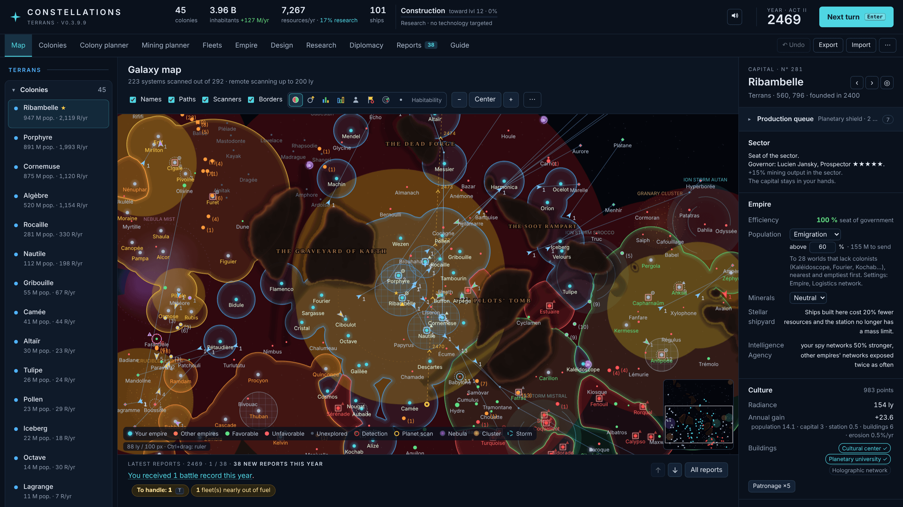
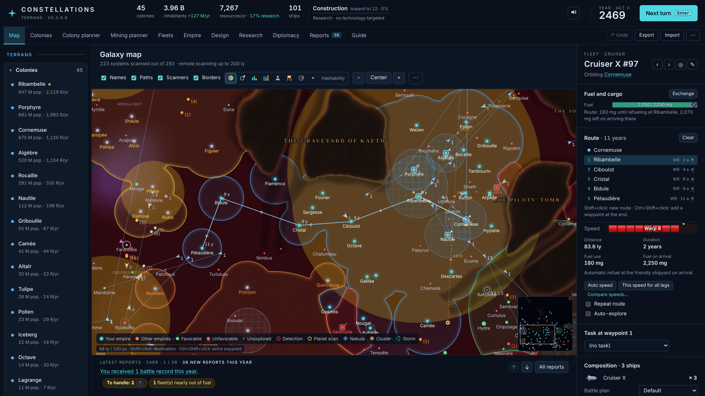
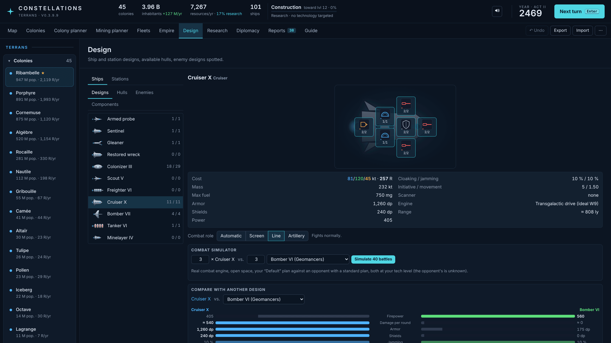
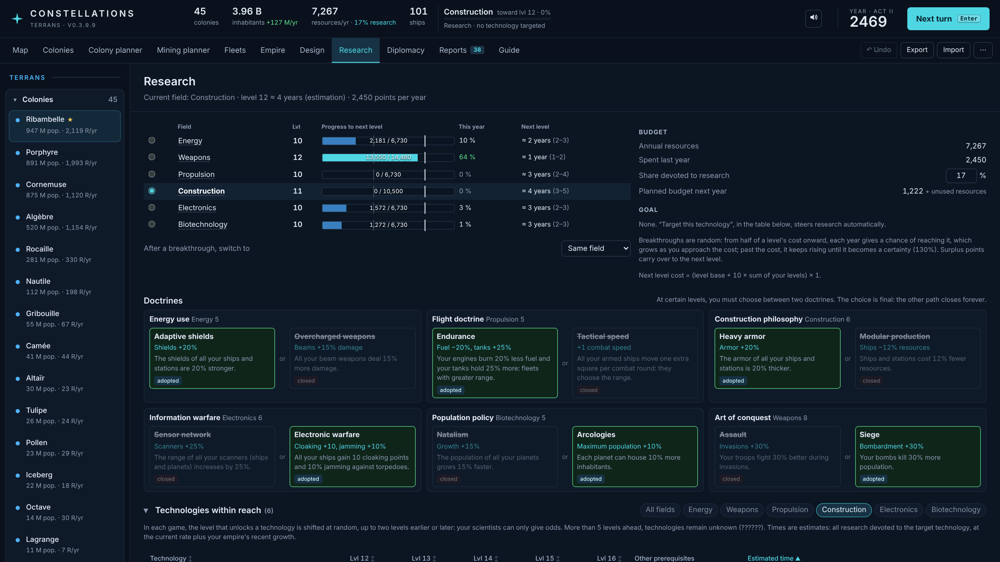
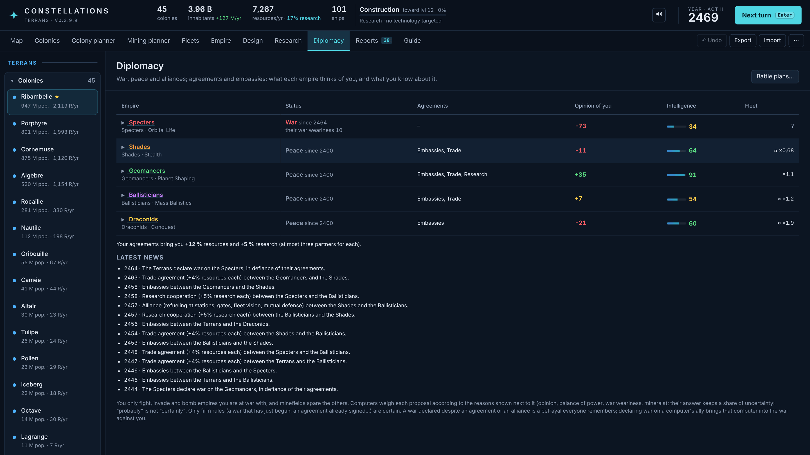
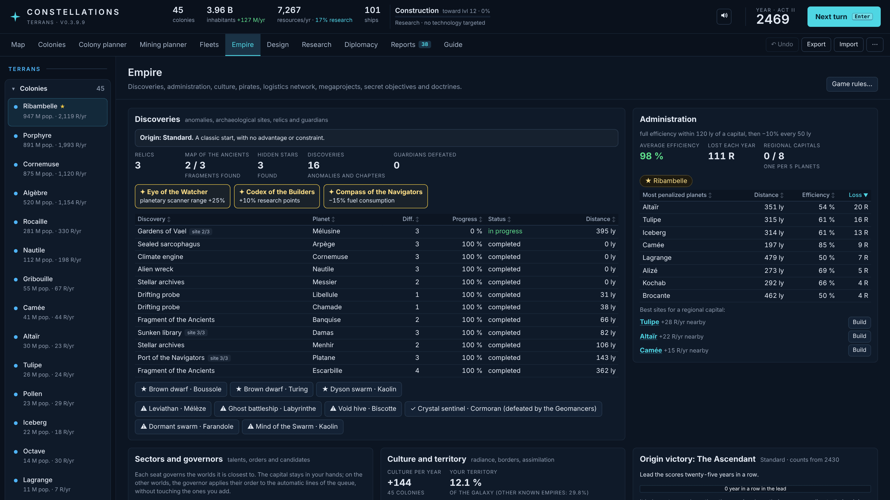
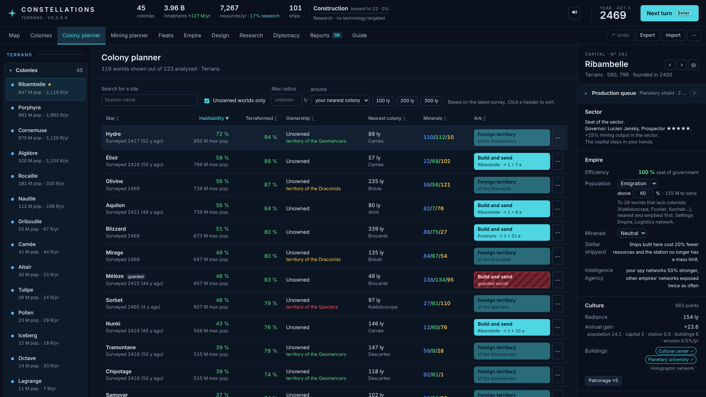
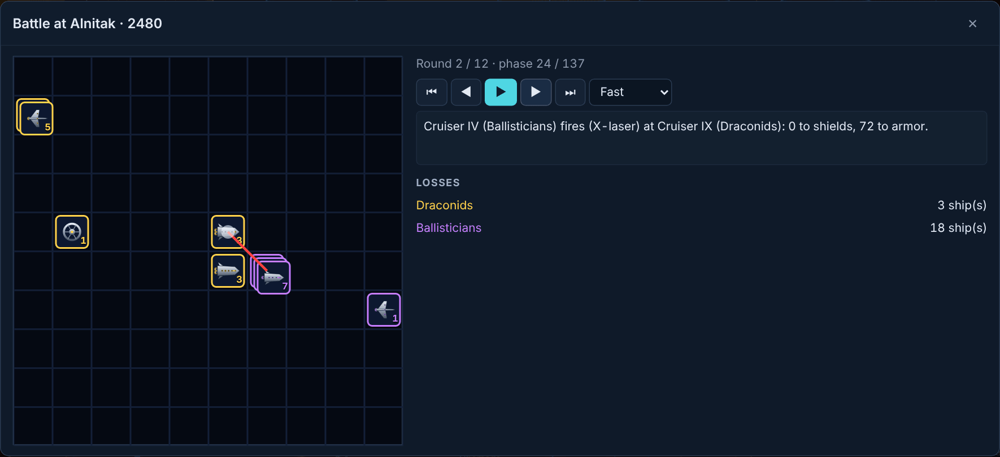
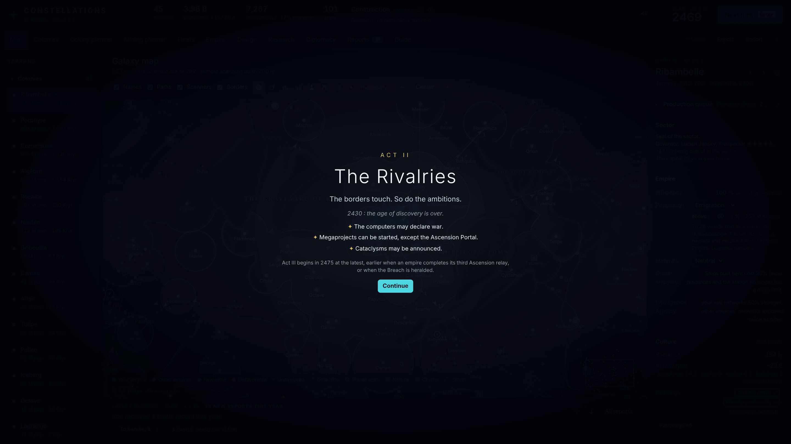
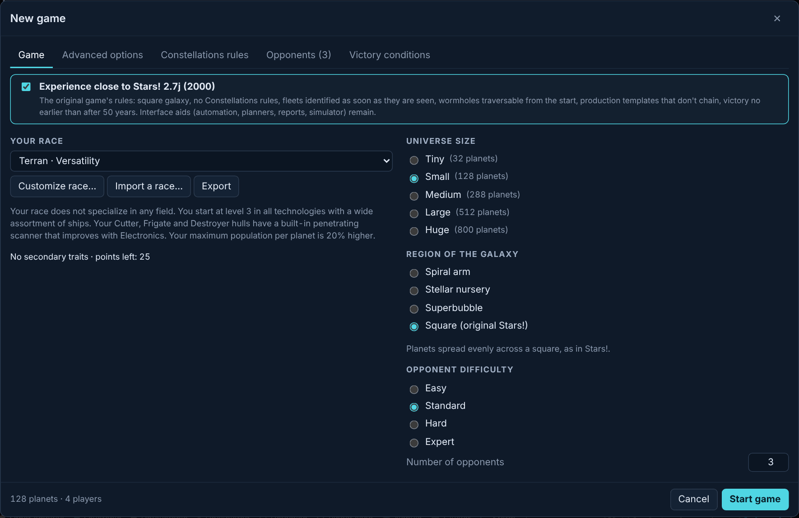

# Constellations

*English · [Français](README.fr.md)*

A turn-based 4X space strategy game, **freely inspired by Stars!** (Jeff Johnson & Jeff McBride, 1995). It runs
entirely in the browser, offline, with nothing to install.

**[▶ Play it in your browser](https://intelligentrebel.github.io/constellations/)**, or download it to play offline (see [Play](#play)).

**Version 0.3.9.12** (early version: the numbering restarts at 0.x until the game is considered complete).



## Why this game

Constellations started as a personal project: to live again a 1990s game I loved, Stars!, without what has aged
badly. Stars! had remarkable depth (race design, ship design, a real economy, fuel, minefields, battle plans) behind
a Windows 3.1 interface: dozens of small windows, orders given one dialog at a time, numbers you had to work out by
hand, and limits that only came from the computers of the time.

So Constellations keeps the rules of Stars! as its foundation, gives them a modern interface with a great deal of
quality of life, and adds many new mechanics inspired by Stellaris and other 4X games, along with plain common sense.
All the names are its own (hulls, components, races, technologies): it is a tribute, not a copy.

It was created with the help of **Claude Opus 5.5** (Anthropic).

## Screenshots

<table>
<tr>
<td width="50%"><br><sub>A fleet sent across the empire: speed, duration and fuel of each leg, refuelling at friendly shipyards on the way.</sub></td>
<td width="50%"><br><sub>Ship design: the hull's slots, the characteristics, the combat role, a combat simulator and a comparison with an enemy design.</sub></td>
</tr>
<tr>
<td><br><sub>Research: progress in each field, the budget, and the exclusive doctrines (the other path closes for good).</sub></td>
<td><br><sub>Diplomacy with the computers: war and peace, agreements, what each empire thinks of you, the latest news.</sub></td>
</tr>
<tr>
<td><br><sub>The Empire page: discoveries and relics, the cost of distance to the capital, sector governors.</sub></td>
<td><br><sub>The colony planner: every analysed world ranked by habitability, with its minerals and a button to send an ark.</sub></td>
</tr>
<tr>
<td><br><sub>A battle replayed phase by phase, with the losses of each side.</sub></td>
<td><br><sub>A story in three acts, each of which changes the rules of the game.</sub></td>
</tr>
</table>

## Play

- **Online**: [intelligentrebel.github.io/constellations](https://intelligentrebel.github.io/constellations/), nothing
  to install.
- **Offline**: download the repository (green **Code** button, then **Download ZIP**), unzip it and open `index.html` in
  a web browser. No server, no installation, no internet connection needed.
- The online and offline copies keep their saves apart (each in its own browser storage): to move a game from one to
  the other, "Export" it, then "Import" it.
- The game picks the language of your browser; if that language is not supported, it starts in English. You can
  change it on the welcome screen or in the "⋯" menu. Languages: English, 简体中文, Deutsch, Español, Português
  (Brasil), Русский, Français, 日本語, 한국어, Polski, Italiano.
- New to the game? **✦ Tutorial**, on the welcome screen, teaches it step by step in a real game: the essentials
  first (about twenty minutes), then optional chapters on everything else.
- Games are saved automatically in the browser (up to eight). "Export" writes a file you can import again; Chrome and
  Edge can also keep backup files of the last turns in a folder you choose.

## For purists: close to the original

**New game, Game tab: "Experience close to Stars!"** switches every Constellations rule off at once: square galaxy, no new
mechanics, fleets identified as soon as they are seen, wormholes crossable from the start, production templates that
do not chain, victory no earlier than after 50 years. The formulas are those of Stars! (from its decompiled help and
the open-source craig-stars project, checked against the original game under Windows 3.11).

The interface improvements stay: you play the Stars! rules with the comfort of a modern game. Each new rule can also be
switched on or off one by one.

<p align="center"></p>

## What differs from Stars!

### Interface and quality of life

- A single modern screen: map, tabs (colonies, colony and mining planners, fleets, empire, design, research,
  diplomacy, reports, guide), a side panel for the selection, and keyboard shortcuts for everything.
- Every report is clickable: the name of a planet, a fleet or a battle opens it. Reports are sorted by importance and
  routine builds are summed up in one line a year.
- Tooltips explain every technology, component and figure; every table can be sorted; undo (Ctrl+Z) for orders.
- One-click missions: send a scout, an ark or a miner, or build one that leaves by itself once ready.
- Routes: fuel gauge with the forecast, speed and duration of each leg, legs crossed without stopping, warnings when
  fuel runs short, at overwarp or through a known minefield (slowing down only inside the field), engine graphs.
- Interception in one click with a standing pursuit, refuelling in flight, tankers on post, merging and splitting
  fleets, automatic exploration (a technology to research, as in Stellaris: exploring by hand early on is part of the
  fun).
- Foreign fleets: estimated speed, heading and trajectory from the second sighting, warnings when one seems to head for
  one of your worlds.
- Production templates that follow a colony as it grows, automatic items, research goals (aim at a technology and see
  when it arrives), a combat simulator, a side-by-side comparison of designs, battle replays.
- A "To handle" queue (key T) of everything waiting for an order this year; a victory race (key W); a chronicle of the
  game with a replay of the map (key H); a shareable page at the end of the game; achievements.
- Ship designs can be withdrawn without destroying the ships already built (a limit of 1996 that made no sense).
- Populations shown in millions, text size and colour-blind palettes, adaptive music and sound effects.
- Several players: on one device (hot seat), or each at home by turn files, as Stars! was played by e-mail.

### New rules (each can be switched off)

- **Realistic maps**: a game takes place in a region of a galaxy (the edge of a spiral arm, a stellar nursery, a
  superbubble), with impassable dark clouds that fleets route around, nebulae, dense clusters, drifting ion storms,
  hidden stars found by quests, and announced cataclysms (supernovae, a wandering black hole).
- **Empire**: efficiency falls with the distance to a capital, regional capitals, conquered worlds that take a
  generation to produce fully; sector governors with talents and standing orders for the production queues;
  culture, borders (they can be closed to an empire: going in is then war, as in Stellaris) and assimilation;
  golden ages; a logistics network with migration and mining policies and
  automatic convoys (that can be raided).
- **Research**: random breakthroughs (as in Master of Orion 2), a variable technology tree, exclusive doctrines.
- **Combat**: screen, line and artillery roles, targeting by threat, retreat thresholds, veteran crews that gain ranks,
  decoys and uncertain contacts, operations (a fleet kept at a number of ships by reinforcements the shipyards build).
- **Diplomacy and intelligence**: war, peace, alliances, treaties and tributes negotiated with the computers (their
  answers given as odds), opinions with their reasons, embassies, spies, a nemesis that swears your downfall.
- **A living galaxy**: anomalies and archaeological sites, relics, guardians on rich worlds, pirate lairs and raids,
  a wandering merchant, an endgame crisis (the Breach and its Harvesters).
- **A story**: an origin for each empire with a victory of its own, three acts with their title cards, dilemmas with
  their price, stories that unfold over decades, the secret of the Ancients and the Seal that closes the Breach,
  secret objectives, megaprojects (one of them wins the game).

The French README has the detailed rules and the full history of versions.

## Bugs and ideas

Bug reports and ideas are welcome in the **Issues** tab (in English or French). For a bug, attaching the exported game
("Export", then the `.json` file) makes it possible to replay exactly what happened.

This repository does not take code contributions (pull requests are disabled).

## Develop

```
npm install
npm run build       # index.html (root, standalone) + dist/artifact.html (hosted version)
npm run typecheck
npm test            # engine tests, including values measured in the real Stars!
npm run sim -- 150 Small   # computer against computer for 150 years
npm run fuzz              # random orders and invariant checks
npx tsx scripts/tutorial-check.ts   # plays the whole tutorial without a browser
npx tsx scripts/v39-check.ts        # checks of the latest features (one script per version)
```

Code: `src/engine` (rules, no browser dependency, 100 % JSON state, deterministic randomness), `src/ui` (Preact),
`src/data` (component and hull tables; `labels.ts` gives their displayed names), `src/i18n.ts` (translation runtime),
`i18n/` (catalogues). The sources are written in French; at build time every player-visible text is replaced by a
lookup in the catalogue of the player's language (`i18n/<lang>.json`), with English then French as fallbacks.

## Rights

© 2026 IntelligentRebel. All rights reserved: no licence is granted for now. You may play the game and read its code,
but not reuse or redistribute it.

Stars! is a trademark of its respective owners. Constellations is an independent tribute, not affiliated with them,
and uses none of their code or assets.

The game data tables are derived from craig-stars, and the page bundles Preact and fflate, all three under the MIT
licence: see [THIRD-PARTY-NOTICES.md](THIRD-PARTY-NOTICES.md).
